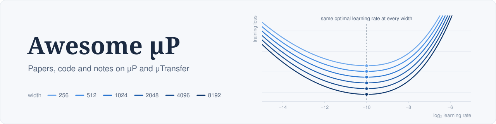

A curated collection of papers, code, and resources on [μP](#mup), [Hyperball optimization](#hyperball), and [cross-scale hyperparameter transfer](#others).

## Contents

- [μP](#mup)
  - [Papers](#mup-papers)
  - [Resources](#mup-resources)
  - [Code](#mup-implementations)
- [Hyperball](#hyperball)
  - [Papers](#hyperball-papers)
  - [Resources](#hyperball-learning-resources-and-reports)
  - [Code](#hyperball-implementations-and-artifacts)
- [Others](#others)
  - [Papers](#complementary-direct-papers)
  - [Resources](#scale-aware-hpt-learning-resources)
  - [Code](#scale-aware-hpt-implementations-and-artifacts)

## μP

Maximal-update parametrization, μTransfer, coordinate checks, and architecture-specific scaling rules.

**173 papers · 63 resources · 102 code / artifact entries.**

[Guide](docs/mup-transfer.md) · [BibTeX](papers/mup-transfer.bib)

### Papers

| Date | Paper | Main contribution | Tags |
|---|---|---|---|
| 2026-10-16 | [Towards Hyperparameter Transfer for Differentially Private Optimization](https://arxiv.org/abs/2610.22976) | Introduces DP-μP through spectral update scaling and layer-wise signal-to-noise matching for DP-SGD / Adam / Muon, validating width transfer in MLPs, ViTs, and 76M→788M GPT-2 models on character-level Shakespeare; analysis assumes noise-dominated updates and does not cover depth transfer. | μP extension, differential privacy, SNR matching, width transfer, DP-Muon |
| 2026-10-15 | [Measuring the local shape of learning-rate transfer curves](https://arxiv.org/abs/2610.21814) | Proposes conditional edge-of-stability and heuristic fixed-point LR-gradient diagnostics, profiles layer-wise sensitivity, and directly tests how output multipliers affect μP width transfer in ResNets; the diagnostics do not supply a universal target-optimal LR formula. | μP analysis, width transfer, LR sensitivity, output multiplier, edge of stability |
| 2026-10-10 | [ShellElastic: Scalable Elastic Pretraining with Simultaneous Maximal Updates and Hyperparameter Transfer](https://arxiv.org/abs/2610.15124) | Extends μP to weight-shared elastic Transformers with groupwise μ-Elastic rules for simultaneous maximal updates, and independently checks proxy learning-rate / initialization transfer across elastic families at 119M–906M; scaling arguments use stated heuristic assumptions and do not prove finite-scale optimality. | μP extension, μ-Elastic, elastic Transformers, width-shell transfer, shared weights |
| 2026-10-08 | [σTransfer: Uncertainty Transfer from Small to Large Networks under μP](https://arxiv.org/abs/2610.11668) | Derives μP-aware Laplace prior-covariance scaling and tests zero-shot prior-precision / uncertainty-decision transfer in MLPs and Transformer readouts, including public 1B→7B models; its kernel theorem is fixed-depth, finite-step MLP theory, not a general joint width-depth guarantee. | μP extension, σTransfer, Bayesian inference, prior precision, uncertainty transfer |
| 2026-10-05 | [How to scale your HEP ML models: A recipe for robust architecture comparisons at scale](https://arxiv.org/abs/2610.06784) | Validates Complete(d)P width learning-rate transfer in jet-tagging Transformers and fits an additional approximately inverse-square-root depth correction before calibrating batch / training-horizon optima; uncorrected depth invariance is imperfect. | application study, μP, Complete(d)P, width transfer, depth correction, HEP |
| 2026-10-03 | [Kolibri: A Sovereign European Model on the Pareto Frontier](https://aleph-alpha.com/downloads/tech-report.pdf) | Validates spectral-μP / Muon width transfer at 1024–2048 with a measured √2 optimum drift, then uses a width-halved, depth-matched proxy and loss extrapolation to choose learning rate / batch / weight decay for a 20T-token MoE target; internal forecast validation is author-reported and the target optimum is not independently swept. | application report, μP, Muon, MoE, width transfer, token-horizon extrapolation, limitation |
| 2026-10-01 | [TACO: Ternary Absolute-max Column-wise One-sparse Optimizer for LLM Fine-Tuning](https://arxiv.org/abs/2610.02199) | Derives μP spectral update scaling for column-wise Top-1 updates under balanced row winners and independently validates a shared learning-rate optimum across OPT / Qwen3 full-parameter fine-tuning scales; not an unconditional pretraining transfer guarantee. | μP, spectral scaling, TACO, sparse optimizer, post-training scale, transfer caveat |
| 2026-10-01 | [Learning Rate Transfer for Hybrid Transformer-SSM Architectures](https://arxiv.org/abs/2610.01172) | Validates original μP with AdamW in hybrid Transformer–SSM width sweeps up to 1.24B despite failed coordinate checks, including small Nemotron-H-style reproductions; single-LR long runs do not independently verify long-horizon target optimality. | μP, hybrid SSM, width LR transfer, coordinate-check limitation, AdamW |
| 2026-09-30 | [Transferable Graph Metanetworks](https://arxiv.org/abs/2610.00420) | Uses μP-trained MLP / CNN weight populations as a central width-generalization control, validates one proxy learning rate for INR fits up to width 1024, and proves finite-horizon size-generalization guarantees for matrix-product metanetworks on μP-trained MLP inputs. | μP application, weight-space learning, graph metanetworks, width transfer, Tensor Programs |
| 2026-09-28 | [Fast Learning Rate Transfer in Shallow Linear Networks at Growing Training Horizons](https://arxiv.org/abs/2609.35029) | Proves fast width-LR transfer for μP-initialized shallow linear networks with one trainable hidden matrix at a common growing horizon T=o(√n), under fixed-data spectral assumptions; not transfer between different training durations. | μP, fast transfer, shallow linear, finite-width theory, growing horizon |
| 2026-08-20 | [Let's Scale Step by Step: Compute-Efficient Hyperparameter Transfer for Large-Scale Mixture-of-Experts](https://arxiv.org/abs/2608.20061) | Adapts μP to MLA-MoE models trained with Muon, validates one optimal learning rate while jointly widening the model and increasing total experts, then fits a proxy token-horizon law used for 155B-total / 17B-active pretraining over 10T tokens. | application report, μP, MoE, Muon, MLA, width-expert transfer, token horizon |
| 2026-08-19 | [Activation-Keyed Momentum: An Anisotropic Momentum Update via the Delta Rule](https://arxiv.org/abs/2608.19491) | Derives a width-invariant delta-rule momentum coefficient under μP, checks activation and effective-update scales across widths 128–2048, and transfers a 67M proxy's hyperparameters to 370M / 1B language models; formerly titled DeltaMomentum. | μP extension, AK-Momentum, optimizer, width transfer, coordinate check |
| 2026-07-30 | [Chimera: Designing and Chinchilla-Scaling Hybrid Visual Diffusion Transformers](https://arxiv.org/abs/2607.28611) | Builds HeteroP from μP / CompleteP, scaling tensors by functional fan-in and block depth so one proxy-tuned base learning rate transfers across a heterogeneous diffusion Transformer / MoE family. | application report, μP extension, HeteroP, width-depth transfer, MoE |
| 2026-07-06 | [Hyperparameter Transfer in Graph Neural Networks](https://arxiv.org/abs/2607.05017) | Extends Tensor Programs IV/V maximal-update reasoning to GNNs under SGD, Adam, and AdamW, yielding stable feature updates and learning-rate transfer across width and depth. | μP extension, GNNs, width-depth transfer |
| 2026-06-16 | [On the Residual Scaling of Looped Transformers: Stability and Transferability](https://arxiv.org/abs/2606.18524) | Applies maximal-update conditions to weight-tied looped Transformers and derives residual scaling that preserves learning-rate transfer across loop counts. | maximal update, looped Transformers, residual scaling |
| 2026-06-16 | [Learning Rate Transfer and Feature Learning Across Depth for Constrained Spectral Optimizers: Complete Scion](https://openreview.net/forum?id=TGiJpGVPNA) | Extends CompleteP-style depth scaling to constrained spectral optimizers such as Scion, supporting width- and depth-wise learning-rate transfer. | Scion, depth transfer |
| 2026-06-04 | [Double Preconditioning (DoPr): Optimization for Test-Time Performance, not Validation Loss](https://arxiv.org/abs/2606.06418) | Shows activation preconditioning preserves magnitude-based μP rules, so AdamW, Muon, and Shampoo learning-rate / weight-decay width scalings port to DoPr, and validates DoPr-AdamW width transfer. | μP compatibility, DoPr, width transfer, LR-WD scaling |
| 2026-06-02 | [Unlocking Feature Learning in Gated Delta Networks at Scale](https://arxiv.org/abs/2606.04048) | Derives μP scaling rules for Gated Delta Networks and validates width learning-rate transfer under AdamW and SGD. | Gated Delta Networks, sequence models |
| 2026-05-29 | [Fast Learning Rate Transfer for Gradient Descent in Sketched Linear Regression](https://openreview.net/forum?id=WMHm9bkItE) | Analyzes the finite-width convergence rate behind μTransfer in a solvable sketched-linear model, proving unconditional fast optimal-LR transfer at fixed horizons and conditional fast-transfer regimes when width and horizon grow jointly. | μTransfer, fast transfer, optimal LR, finite-width theory, sketched linear regression, HiLD 2026 |
| 2026-05-29 | [Why Routers Freeze: Infinite Width Learning Dynamics for Mixture of Experts](https://openreview.net/forum?id=AhwB471ARJ) | Uses Tensor Programs to show router saturation under standard parameterization and derives μP-MoE scaling for stable router dynamics. | MoE, routers, OpenReview |
| 2026-05-29 | [Depth scaling and Muon enable balanced expert usage in MoE training](https://openreview.net/forum?id=2PAe0L8PME) | Extends 1/√L Depth-μP residual scaling to MoE routing, deriving depth-stable hidden-state concentration and router-balance guarantees and validating the mechanism at initialization and in toy pretraining with Muon; it does not test optimal-LR transfer across multiple depths. | Depth-μP extension, MoE, Muon, routing balance, HiLD 2026 |
| 2026-05-25 | [Scaling Limits of Deep Reinforcement Learning: A Stability Analysis with Maximal Update Parametrization](https://proceedings.mlr.press/v318/ghasemi26a.html) | Compares width scaling of Deep Q-Networks under mean-field, NTK, and μP; μP prevents the tested large-width divergence and rank collapse, with more conservative returns. | μP, reinforcement learning, width scaling, stability, trade-off |
| 2026-05-23 | [Feature Learning in Wide Neural Networks under μP: Identifiability and Sparse-Dictionary Decomposition of the Mean-Field Limit](https://arxiv.org/abs/2605.24710) | Studies identifiability, sparse-dictionary structure, and mean-field feature-learning limits for wide two-layer networks under μP. | mean field, identifiability |
| 2026-05-22 | [Complete-muE: Optimal Hyperparameter Transfer and Scaling for MoE Models](https://arxiv.org/abs/2605.23893) | Extends hyperparameter transfer across dense FFN and MoE settings via active-width μP and expert-capacity scaling. | MoE, Complete-muE |
| 2026-05-20 | [Quantifying Hyperparameter Transfer and the Importance of Embedding Layer Learning Rate](https://arxiv.org/abs/2605.21486) | Defines transfer-quality metrics and argues that embedding learning-rate scaling explains much of μP's practical AdamW benefit in LMs. | embedding LR, AdamW |
| 2026-05-19 | [Toto 2.0: Time Series Forecasting Enters the Scaling Era](https://arxiv.org/abs/2605.20119) | Tunes a 10M proxy once with u-μP and transfers the recipe to five 4M–2.5B time-series Transformers, while documenting distributed/FSDP implementation adaptations. | application report, u-μP, proxy-to-target transfer |
| 2026-05-14 | [GQA-μP: The maximal parameterization update for grouped query attention](https://arxiv.org/abs/2605.15290) | Derives μP scalings for grouped-query attention and studies transfer over GQA repetition and weight decay. | GQA, attention |
| 2026-05-13 | [How to Scale Mixture-of-Experts: From muP to the Maximally Scale-Stable Parameterization](https://arxiv.org/abs/2605.14200) | Analyzes MoE scaling regimes, shows where μP transfer can fail, and derives MSSP for robust learning-rate transfer. | MoE, MSSP |
| 2026-05-13 | [When is Warmstarting Effective for Scaling Language Models?](https://arxiv.org/abs/2605.13405) | Uses μP as the controlled width-transfer baseline for warmstarting, transferring the best width-48 configuration to larger MLPs and all language-model scales while testing when model growth remains compute-efficient. | warmstart, μP, width transfer, experimental control |
| 2026-05-13 | [Mix, Don't Tune: Bilingual Pre-Training Outperforms Hyperparameter Search in Data-Constrained Settings](https://arxiv.org/abs/2605.13225) | Transfers AdamW learning rate and weight decay from a 150M μP proxy to 380M–1.43B bilingual models and validates the transferred settings against per-scale hyperparameter searches. | application study, μP, proxy-to-target transfer, LR-WD scaling, bilingual pretraining |
| 2026-05-11 | [Hyperparameter Transfer for Dense Associative Memories](https://arxiv.org/abs/2605.10164) | Extends μP-style maximal-update prescriptions to Dense Associative Memories with shared weights and sharp activations. | μP extension, DenseAM, HPT |
| 2026-05-09 | [Sparse Layers are Critical to Scaling Looped Language Models](https://arxiv.org/abs/2605.09165) | Extends μP to shared loop blocks, MoE experts, routers, and unembeddings, then validates learning-rate transfer from width 128 to 1024 with tightly matched loss. | application report, looped Transformer, MoE, μP, width LR transfer, weight sharing |
| 2026-05-08 | [Spectral Dynamics in Deep Networks: Feature Learning, Outlier Escape, and Learning Rate Transfer](https://arxiv.org/abs/2605.07870) | Tracks bulk and outlier spectral dynamics and shows μP yields width-consistent learning-rate transfer in deep linear settings. | spectral dynamics, theory |
| 2026-05-06 | [Demystifying Manifold Constraints in LLM Pre-training](https://arxiv.org/abs/2605.04418) | Tests MACRO with μP-compatible initialization and constraint radii, finding consistent optimal learning rates across widths 256–2048 for both Frobenius and spectral variants. | μP, MACRO, width transfer, manifold constraints |
| 2026-05-05 | [Nora: Normalized Orthogonal Row Alignment for Scalable Matrix Optimizer](https://arxiv.org/abs/2605.03769) | Derives Nora's η∝n^-1/2 rule from μP feature-update conditions; its 60M and 135M experiments tune each scale separately and therefore do not independently validate zero-shot LR transfer. | μP, Nora, Muon, width LR scaling, transfer caveat |
| 2026-04-29 | [Learning Rate Transfer in Normalized Transformers](https://arxiv.org/abs/2604.27077) | Revisits μP for nGPT and proposes νGPT, enabling learning-rate transfer across width, depth, and token horizon. | nGPT, νGPT |
| 2026-04-28 | [Scaling Probabilistic Transformer via Efficient Cross-Scale Hyperparameter Transfer](https://arxiv.org/abs/2604.25409) | Derives a probabilistic-Transformer-specific μP parameterization and validates cross-scale hyperparameter transfer in masked-language-model experiments. | μP extension, probabilistic Transformer, cross-scale HPT |
| 2026-04-22 | [How Much Is One Recurrence Worth? Iso-Depth Scaling Laws for Looped Language Models](https://arxiv.org/abs/2604.21106) | Uses MuonH with μP/HyperP scaling in iso-depth looped/non-looped LM experiments; Appendix D validates width and token-horizon LR transfer at fixed effective depth, not independent depth transfer. Reviewed v3, May 7. | application, MuonH, HyperP, μP, width, token horizon, looped LMs |
| 2026-03-30 | [Rethinking Language Model Scaling under Transferable Hypersphere Optimization](https://arxiv.org/abs/2603.28743) | Derives HyperP from μP and Depth-μP under Frobenius-sphere constraints, then tests MuonH transfer across width, depth, architecture shape, and MoE granularity. | μP extension, Depth-μP, HyperP, MuonH, MoE |
| 2026-03-10 | [On the Width Scaling of Neural Optimizers Under Matrix Operator Norms I: Row/Column Normalization and Hyperparameter Transfer](https://arxiv.org/abs/2603.09952) | Derives MOGA operator-geometry width scalings, exactly recovers μP for Adam/SignSGD, relates them to the spectral condition, and validates width-wise LR invariance. | μP, MOGA, operator norms, optimizers, width LR transfer |
| 2026-02-28 | [Spectral Condition for μP under Width-Depth Scaling](https://arxiv.org/abs/2603.00541) | Builds a unified spectral recipe for μP under joint width-depth scaling, including practical multi-transformation residual blocks. | width-depth, spectral conditions |
| 2026-02-26 | [Summer-22B: A Systematic Approach to Dataset Engineering and Training at Scale for Video Foundation Model](https://arxiv.org/abs/2603.00173) | Transfers a hypersphere-constrained μP recipe from 30M to 1B parameters, while handling the separate 1K→100K training-horizon axis with empirically fitted √T and √B corrections. | application report, video, μP, width transfer, empirical horizon correction |
| 2026-02-24 | [Extending μP: Spectral Conditions for Feature Learning Across Optimizers](https://arxiv.org/abs/2602.20937) | Uses spectral conditions to derive μP-style transfer rules for AdamW, ADOPT, LAMB, Sophia, Shampoo, and Muon. | optimizers, spectral conditions |
| 2026-02-11 | [μpscaling small models: Principled warm starts and hyperparameter transfer](https://arxiv.org/abs/2602.10545) | Introduces μP-motivated upscaling and warm-start methods that preserve hyperparameter transfer when growing model width. | warmstart, upscaling |
| 2026-02-07 | [Hyperparameter Transfer Laws for Non-Recurrent Multi-Path Neural Networks](https://arxiv.org/abs/2602.07494) | Extends maximal-update / AM-μP reasoning to non-recurrent multi-path architectures and derives effective-depth laws for width-depth learning-rate transfer. | maximal update, AM-μP, depth, multi-path |
| 2026-02-07 | [On the Infinite Width and Depth Limits of Predictive Coding Networks](https://arxiv.org/abs/2602.07697) | Shows predictive-coding networks and backpropagation share the same μP width- and depth-stable feature-learning parameterizations. | μP, predictive coding, width-depth |
| 2026-02-05 | [Learning Rate Scaling across LoRA Ranks and Transfer to Full Finetuning](https://arxiv.org/abs/2602.06204) | Introduces Maximal-Update Adaptation (µA), derived from μP feature-update conditions, and validates rank-wise LR scaling plus LoRA-to-full-finetuning transfer. | μA, LoRA, finetuning, LR transfer |
| 2026-01-29 | [Shaping capabilities with token-level data filtering](https://arxiv.org/abs/2601.21571) | Uses depth-matched width-512 μP proxies to select AdamW learning rate and weight decay for data-filtering experiments spanning a language-model family up to 1.816B parameters. | application report, μP, width transfer, depth-matched proxy, data filtering |
| 2026-01-28 | [Hyperparameter Transfer with Mixture-of-Expert Layers](https://arxiv.org/abs/2601.20205) | Extends μP-style Transformer parameterization to transfer hyperparameters across width, depth, expert count, and expert size. | μP extension, MoE, HPT |
| 2026-01-19 | [Scaling laws for amplitude surrogates](https://arxiv.org/abs/2601.13308) | Gives explicit μP initialization and learning-rate rules, validating width-wise LR invariance for MLP surrogates while reporting transfer instability for the LLoCa-Transformer family. | application report, scientific ML, μP, width LR transfer, negative result |
| 2026-01-15 | [On the origin of neural scaling laws: from random graphs to natural language](https://arxiv.org/abs/2601.10684) | Uses μP throughout synthetic-sequence scaling experiments and directly compares μP with standard parameterization on language, finding preliminary evidence for a larger model-size exponent and a different compute-optimal parameter/token allocation. | μP analysis, scaling laws, parameter efficiency, compute-optimal scaling |
| 2026-01-13 | [Controlled LLM Training on Spectral Sphere](https://arxiv.org/abs/2601.08393) | Matches a spectral-sphere optimizer to μP spectral conditions and transfers a single optimal learning rate across widths 256–2048 and 70M–1.8B language models while controlling weight and update scales. | spectral μP, optimal-LR transfer, width scaling, optimizer |
| 2026-01-08 | [How to Set the Learning Rate for Large-Scale Pre-training?](https://arxiv.org/abs/2601.05049) | Compares fitted LR scaling laws with transfer, extending μTransfer to MoE, depth, weight decay, and token horizons while documenting large-scale limits. | μTransfer, MoE, token horizon |
| 2026-01-08 | [Learnable Multipliers: Freeing the Scale of Language Model Matrix Layers](https://arxiv.org/abs/2601.04890) | Introduces learnable row/column multipliers as a more expressive generalization of μP multipliers, compares against tuned μP baselines, and analyzes width scaling; a complete transfer parameterization remains open. | μP extension, multipliers, LLMs, transfer limitation |
| 2026-01-06 | [From Entropy to Epiplexity: Rethinking Information for Computationally Bounded Intelligence](https://arxiv.org/abs/2601.03220) | Tunes learning rate on small models and applies μP plus CompleteP across width, depth, and aspect ratio when estimating learnable information in data. | application report, μP, CompleteP, width-depth-aspect transfer |
| 2026-01-04 | [Towards a Principled Muon under μP: Ensuring Spectral Conditions throughout Training](https://arxiv.org/abs/2601.01306) | Develops Muon++ to maintain μP spectral conditions throughout training without repeated weight normalization. | Muon, spectral conditions |
| 2025-12-31 | [Dynamic Large Concept Models: Latent Reasoning in an Adaptive Semantic Space](https://arxiv.org/abs/2512.24617) | Uses decoupled μP parameterization for zero-shot hyperparameter transfer across widths and compression regimes. | application report, decoupled μP |
| 2025-12-28 | [Understanding the Mechanisms of Fast Hyperparameter Transfer](https://arxiv.org/abs/2512.22768) | Formalizes fast hyperparameter transfer and studies when μP transfer is compute-efficient versus when it fails. | mechanism, fast transfer |
| 2025-12-26 | [Completed Hyperparameter Transfer across Modules, Width, Depth, Batch and Duration](https://arxiv.org/abs/2512.22382) | Extends CompleteP-style transfer to modules, width, depth, batch size, training duration, and per-module hyperparameters; accepted as an [ICLR 2026 Poster](https://openreview.net/forum?id=elB9k4nTL1), after initially being submitted as “Transfer Paramatters.” | CompleteP, batch, duration |
| 2025-12-24 | [Feature Learning Dynamics in Infinite-Depth Neural Networks](https://arxiv.org/abs/2512.21075) | Gives a rigorous feature-learning limit for one-layer ResNets under depth-μP and quantifies how forward-backward weight-reuse effects vanish with depth. | depth-μP, infinite depth, theory |
| 2025-12-22 | [DIVER-1: Scaling Intracranial EEG Foundation Models for Transferable Representations](https://arxiv.org/abs/2512.19097) | Tunes a 50M proxy, applies μTransfer across the 13M–1.83B family, and reports a width-256–1024 coordinate check before its compute/data-scaling study. | application report, iEEG foundation model, μTransfer, coordinate check, model-data scaling |
| 2025-12-20 | [Towards Guided Descent: Optimization Algorithms for Training Neural Networks At Scale](https://arxiv.org/abs/2512.18373) | Devotes a full chapter to maximal-update parameterization, μTransfer, optimizer dependence, activation/depth scaling, local learning, and u-μP implementation recipes. | survey, μP, μTransfer, optimization |
| 2025-12-11 | [Scaling Behavior of Discrete Diffusion Language Models](https://arxiv.org/abs/2512.10858) | Uses CompleteP to transfer a recipe from 25M / 50M proxies across width and depth in discrete diffusion LMs, while identifying batch size and token horizon as separate corrections. | application report, discrete diffusion LM, CompleteP, width-depth transfer, batch, token horizon |
| 2025-12-09 | [Jais 2: A Family of Arabic-Centric Open Large Language Models](https://jais.pages.dev/assets/tech-paper/Jais_2_family.pdf) | Tunes base learning rate, initialization, embedding / unembedding multipliers, and layerwise scales on a 100M, width-256, depth-68 μP proxy before transferring the recipe to the 8B and 70B models. | application report, Arabic LLM, μP, width transfer, depth-matched proxy |
| 2025-12-05 | [Hyperparameter Transfer Enables Consistent Gains of Matrix-Preconditioned Optimizers Across Scales](https://arxiv.org/abs/2512.05620) | Derives μP width/depth learning-rate and epsilon rules for Shampoo, SOAP, and Muon, then shows how blocking and spectral normalization reduce finite-width drift in transfer experiments from 190M to 1.4B parameters. | μP, matrix preconditioners, Muon, width-depth transfer, finite-width effects |
| 2025-11-23 | [Xmodel-2.5: 1.3B Data-Efficient Reasoning SLM](https://arxiv.org/abs/2511.19496) | Uses μP to transfer hyperparameters from a 20M proxy to a 1.3B small language model. | application report, SLM |
| 2025-11-14 | [Training Neural Networks at Any Scale](https://arxiv.org/abs/2511.11163) | Reviews scale-agnostic optimization, μP, coordinate checks, and parameterization-aware rules for keeping training behavior stable across model scales. | survey, scale-agnostic optimization |
| 2025-11-07 | [Scaling depth capacity via zero/one-layer model expansion](https://arxiv.org/abs/2511.04981) | Uses μP spectral conditions to classify depth-expansion initializations and validates a Muon-NSGD μP-scaled recipe that reuses hyperparameters before and after zero/one-layer expansion; the focus is progressive depth growth rather than a general Depth-μP theorem. | μP analysis, depth expansion, hyperparameter transfer, Muon-NSGD, progressive training |
| 2025-11-03 | [A Proof of Learning Rate Transfer under μP](https://arxiv.org/abs/2511.01734) | Proves width learning-rate transfer for linear MLPs under μP and contrasts it with SP and NTP. | theory, LR transfer |
| 2025-10-21 | [Weight Decay may matter more than muP for Learning Rate Transfer in Practice](https://arxiv.org/abs/2510.19093) | Challenges the practical mechanism of μP transfer in LLM settings and argues weight decay often stabilizes representation updates after early training. | critique, weight decay |
| 2025-10-17 | [Robust Layerwise Scaling Rules by Proper Weight Decay Tuning](https://arxiv.org/abs/2510.15262) | Extends μP into the AdamW steady state: combining μP's matrix LR rule η∝d^-1 with λ∝√d preserves sublayer gains and restores zero-shot LR–WD transfer across width. | μP extension, weight decay, AdamW, width transfer |
| 2025-10-05 | [Arithmetic-Mean μP for Modern Architectures: A Unified Learning-Rate Scale for CNNs and ResNets](https://arxiv.org/abs/2510.04327) | Replaces per-layer maximal-update constraints with an average update criterion for CNNs and ResNets, yielding width-robust depth laws. | AM-μP, CNNs, ResNets |
| 2025-09-29 | [Predicting Training Re-evaluation Curves Enables Effective Data Curriculums for LLMs](https://arxiv.org/abs/2509.25380) | Uses a 39M μP proxy sweep to align training hyperparameters from 111M to 3.9B parameters, then transfers a re-evaluation-timescale fit across sizes to design data curricula. | application report, μP, data curriculum, optimizer timescale, model scale |
| 2025-09-29 | [Scaling with Collapse: Efficient and Predictable Training of LLM Families](https://arxiv.org/abs/2509.25087) | Validates μP training-curve collapse at LLM scale when tokens per parameter, LR schedule, and AdamW timescale are scaled consistently. | μP application, TPP, AdamW |
| 2025-09-18 | [CompleteP for RL: Maintaining Feature Learning When Scaling Deep Reinforcement Learning](https://openreview.net/forum?id=3uXAGWqCny) | Applies CompleteP to non-stationary reinforcement learning and demonstrates learning-rate transfer plus feature and policy consistency across width and depth; accepted at ICML 2026, with the [earlier ICLR submission](https://openreview.net/forum?id=Wuy631kHwH) retained for version history. | CompleteP, reinforcement learning, ICML 2026 |
| 2025-09-18 | [Optimal Scaling Needs Optimal Norm](https://openreview.net/forum?id=YhXudigLNR) | Implements the μP spectral condition with layerwise Scion operator norms, then finds an output-norm invariant across width, depth, batch, and token horizon while fitting the corresponding optimal LR–batch scaling law. | maximal update, spectral condition, Scion, multi-axis invariant, LR-batch scaling |
| 2025-09-12 | [The Hidden Width of Deep ResNets: Tight Error Bounds and Phase Diagram](https://arxiv.org/abs/2509.10167) | Extends CompleteP's proportional width–depth result to general non-proportional (L,M,D) limits and derives residual scaling necessary and sufficient for maximal local feature updates. | CompleteP extension, feature learning, width-depth limit, residual scaling, theory |
| 2025-08-13 | [FM4NPP: A Scaling Foundation Model for Nuclear and Particle Physics](https://arxiv.org/abs/2508.14087) | Derives μP-SSM rules for Mamba state-space matrices and validates them with layerwise activation and update coordinate checks, where standard or heuristic μP variants become unstable. | application report, scientific foundation model, μP-SSM, Mamba, coordinate check |
| 2025-08-13 | [μ-Parametrization for Mixture of Experts](https://arxiv.org/abs/2508.09752) | Derives μ-parameterization rules for MoE models and demonstrates learning-rate transfer across model sizes. | MoE, μTransfer |
| 2025-08-12 | [SwiFT V2: Towards Large-scale Foundation Model for Functional MRI](https://2025.ccneuro.org/poster/?id=uuIklCkuIX) | Implements μP for 4D fMRI Transformers, verifies width-stable activations with coordinate checks, and transfers smaller-model hyperparameters to models up to 8.8B; the largest model was still training in this CCN extended abstract. | application report, μP, μTransfer, fMRI, coordinate check, CCN 2025 |
| 2025-07-30 | [Falcon-H1: A Family of Hybrid-Head Language Models Redefining Efficiency and Performance](https://arxiv.org/abs/2507.22448) | Tunes architecture-specific μP multipliers on 300M–1.5B hybrid attention / SSM proxies and applies the transferred recipe across the 0.5B–34B Falcon-H1 family. | application report, hybrid LLM, μP, proxy-to-target transfer |
| 2025-07-11 | [Pre-Training LLMs on a budget: A comparison of three optimizers](https://arxiv.org/abs/2507.08472) | Tunes optimizer-specific μP recipes on a 50M proxy and transfers them through a 2.7B target; appendix width sweeps independently verify LR transfer for AdamW, Lion, and Sophia. | application report, μP, optimizer comparison, width LR transfer, LLM |
| 2025-07-09 | [Decoder-Hybrid-Decoder Architecture for Efficient Reasoning with Long Generation](https://arxiv.org/abs/2507.06607) | Introduces μP++ by combining μP, Depth-μP, and zero weight decay on vector/scalar-like parameters, then validates stability in scaling studies up to 3.4B parameters / 600B tokens; the final 3.8B production model used SP. | μP++, Depth-μP, width-depth scaling, weight decay, hybrid LLM, negative result |
| 2025-07-06 | [Transfer Learning in Infinite Width Feature Learning Networks](https://arxiv.org/abs/2507.04448) | Develops source-to-target transfer-learning dynamics in the μP / mean-field feature-learning limit and characterizes when limited source data or task misalignment causes negative transfer. | μP analysis, transfer learning, mean field, adaptive kernels, negative transfer |
| 2025-07-02 | [Scaling Collapse Reveals Universal Dynamics in Compute-Optimally Trained Neural Networks](https://arxiv.org/abs/2507.02119) | Uses μP throughout a Transformer scaling ladder and directly ablates the parameterization while studying when suboptimal hyperparameter scaling breaks compute-optimal collapse. | μP application, scaling collapse, parameterization ablation |
| 2025-06-27 | [HyperCLOVA X THINK Technical Report](https://arxiv.org/abs/2506.22403) | Sweeps learning rate and regularization on sub-billion μP proxies, then zero-shot transfers the selected settings to multi-billion HyperCLOVA X THINK production models. | application report, μP, μTransfer, LLM, proxy-to-target |
| 2025-06-24 | [Maximal Update Parametrization and Zero-Shot Hyperparameter Transfer for Fourier Neural Operators](https://arxiv.org/abs/2506.19396) | Derives μTransfer-FNO for scaling Fourier Neural Operators by Fourier modes. | neural operators, PDE |
| 2025-06-20 | [The Importance of Being Lazy: Scaling Limits of Continual Learning](https://arxiv.org/abs/2506.16884) | Directly compares NTP and μP width scalings, finding a task-dependent optimal feature-learning level that transfers across widths in continual learning. | μP, NTP, width transfer, continual learning, DMFT |
| 2025-06-17 | [Optimal Embedding Learning Rate in LLMs: The Effect of Vocabulary Size](https://arxiv.org/abs/2506.15025) | Identifies the fixed-vocabulary assumption behind the usual μP embedding rule and derives a large-vocabulary regime in which the optimal hidden-to-embedding learning-rate ratio grows as the square root of width. | μP limitation, embedding LR, vocabulary, width scaling |
| 2025-06-09 | [MiniCPM4: Ultra-Efficient LLMs on End Devices](https://arxiv.org/abs/2506.07900) | Uses μP-backed small-model hyperparameter searches in the ModelTunnel / ScalingBench pipeline to validate transfer before training end-device LLMs. | application report, SLM, model wind tunnel |
| 2025-05-28 | [On the Surprising Effectiveness of Large Learning Rates under Standard Width Scaling](https://arxiv.org/abs/2505.22491) | Contrasts SP with NTP and μP, then proposes MUSOLI—a maximal-update rule under standard output-layer initialization—to explain large-learning-rate feature learning. | μP analysis, MUSOLI, SP, feature learning |
| 2025-05-26 | [Variational Deep Learning via Implicit Regularization](https://arxiv.org/abs/2505.20235) | Extends μP to variational mean and covariance parameters and validates proxy-selected learning-rate transfer from hidden width 128 to 2048. | variational inference, μP extension, width LR transfer |
| 2025-05-21 | [Scaling Diffusion Transformers Efficiently via μP](https://arxiv.org/abs/2505.15270) | Generalizes μP to diffusion Transformer families such as DiT, U-ViT, PixArt-α, and MMDiT. | diffusion, DiT |
| 2025-05-20 | [The Strawberry Problem: Emergence of Character-level Understanding in Tokenized Language Models](https://arxiv.org/abs/2505.14172) | Uses μP to scale its base encoder from width 512 to 1024 and 2048 while reusing the smaller model's hyperparameters, isolating how model size changes character-level capability emergence. | application report, μP, width transfer, language models |
| 2025-05-19 | [Power Lines: Scaling Laws for Weight Decay and Batch Size in LLM Pre-training](https://arxiv.org/abs/2505.13738) | Holds proxy-tuned μP learning rates fixed while deriving and validating weight-decay and batch-size laws across model and data scale. | μP application, weight decay, batch size |
| 2025-05-19 | [μPC: Scaling Predictive Coding to 100+ Layer Networks](https://arxiv.org/abs/2505.13124) | Derives μPC from Depth-μP and transfers separate weight and activity learning rates zero-shot across width and from 16 to 128 layers in predictive-coding networks. | predictive coding, Depth-μP, width-depth transfer, learning-rate transfer |
| 2025-05-04 | [Practical Efficiency of Muon for Pretraining](https://arxiv.org/abs/2505.02222) | Studies Muon plus maximal update parameterization and gives a telescoping algorithm for efficient μP hyperparameter transfer. | Muon, μP |
| 2025-05-02 | [Don't be lazy: CompleteP enables compute-efficient deep transformers](https://arxiv.org/abs/2505.01618) | Proposes CompleteP for depth-wise hyperparameter transfer while avoiding lazy learning in deep Transformers. | CompleteP, depth, Transformers |
| 2025-05-01 | [Customizing the Inductive Biases of Softmax Attention using Structured Matrices](https://proceedings.mlr.press/v267/kuang25a.html) | Derives μP initialization and AdamW learning-rate scalings for bilinear MLR/BTT structured-attention factors, then validates a shared optimal learning rate across OpenWebText model widths 512–1024. | μP extension, structured attention, MLR, BTT, width transfer |
| 2025-05-01 | [On the Provable Separation of Scales in Maximal Update Parameterization](https://openreview.net/forum?id=csB1njlpjM) | Provides theory for why μP can separate macro-variables from micro-variables, supporting small-scale hyperparameter tuning. | theory, scale separation |
| 2025-04-10 | [On Model and Data Scaling for Skeleton-based Self-Supervised Gait Recognition](https://arxiv.org/abs/2504.07598) | Tunes learning rate and initialization on a small fixed-depth proxy, then uses μP width transfer to study model, data, and compute scaling for gait recognition. | application report, computer vision, μP, width transfer, model-data scaling |
| 2025-04-06 | [Prot42: a Novel Family of Protein Language Models for Target-aware Protein Binder Generation](https://arxiv.org/abs/2504.04453) | Tunes an 81M μP proxy and transfers the selected training recipe to 500M and 1.1B protein language models. | application report, protein language model, μP, width transfer |
| 2025-03-24 | [Scaling Laws for Emulation of Stellar Spectra](https://arxiv.org/abs/2503.18617) | Tunes TransformerPayne μP hyperparameters on a small proxy, validates stable optimal learning rates across widths 64–512 and attention/token axes, and documents that transfer degrades for depth changes beyond roughly 0.5–2× the proxy depth. | application report, scientific ML, μP, width transfer, depth limitation |
| 2025-03-20 | [Chem42: a Family of chemical Language Models for Target-aware Ligand Generation](https://arxiv.org/abs/2503.16563) | Runs a 200-configuration sweep over initialization, embedding / output multipliers, and peak learning rate on a 38M μP proxy before scaling to 190M–1B chemical language models. | application report, chemical language model, μP, width transfer |
| 2025-03-12 | [Global Convergence and Rich Feature Learning in L-Layer Infinite-Width Neural Networks under μP Parametrization](https://arxiv.org/abs/2503.09565) | Proves global convergence while preserving rich feature learning for L-layer infinite-width networks trained with SGD under μP. | theory, global convergence |
| 2025-02-21 | [Straight to Zero: Why Linearly Decaying the Learning Rate to Zero Works Best for LLMs](https://arxiv.org/abs/2502.15938) | Uses μP proxy-to-target transfer to isolate how schedule shape, tokens per parameter, and weight decay affect LLM pretraining. | μP application, linear decay, LLM pretraining |
| 2025-02-21 | [VaViM and VaVAM: Autonomous Driving through Video Generative Modeling](https://arxiv.org/abs/2502.15672) | Sweeps 50 configurations on a width-256, 60M proxy and uses μP to scale the same recipe to 185M and billion-parameter video / action models. | application report, video generation, autonomous driving, μP, width transfer |
| 2025-02-12 | [Distillation Scaling Laws](https://arxiv.org/abs/2502.08606) | Validates a simplified μP parameterization across 198M–1.82B students and 546M–7.75B teachers, finding a shared near-optimal learning rate around 0.01 before fitting distillation scaling laws. | application report, distillation, μP, LR transfer |
| 2025-02-11 | [Adaptive kernel predictors from feature-learning infinite limits of neural networks](https://arxiv.org/abs/2502.07998) | Uses maximal-update parametrization as the rich infinite-width regime and derives deterministic data-adaptive Bayesian and tangent-kernel predictors for noisy gradient flow and weight-decayed gradient flow. | μP analysis, adaptive kernels, DMFT, feature learning, weight decay |
| 2025-02-11 | [Training Deep Learning Models with Norm-Constrained LMOs](https://arxiv.org/abs/2502.07529) | Derives Scion's layerwise norm-constrained updates from the μP spectral condition, proves a width-independent maximal-update learning rate, and validates zero-shot transfer from small proxies through nanoGPT models up to 3B parameters. | maximal update, spectral condition, Scion, Muon, width transfer, proxy-to-target |
| 2025-02-09 | [μnit Scaling: Simple and Scalable FP8 LLM Training](https://arxiv.org/abs/2502.05967) | Proposes μnit Scaling for FP8 LLM training with simple width-wise hyperparameter transfer and matched training/inference numerics. | FP8, u-μP |
| 2025-02-04 | [Deep Linear Network Training Dynamics from Random Initialization: Data, Width, Depth, and Hyperparameter Transfer](https://arxiv.org/abs/2502.02531) | Analyzes deep linear networks under μP, capturing maximal-update feature learning plus width/depth hyperparameter-transfer effects. | μP, deep linear networks, width-depth transfer |
| 2025-01-23 | [A thorough reproduction and evaluation of μP](https://openreview.net/forum?id=AFxEdJwQcp) | TMLR reproduction study evaluating claimed μP benefits, implementation sensitivity, and transfer behavior. | reproduction, TMLR |
| 2024-12-27 | [Xmodel-2 Technical Report](https://arxiv.org/abs/2412.19638) | Uses explicit μP search rules for width, depth, initialization, learning rate, and logits, transferring proxy-model choices to a 1.2B target. | application report, LLM, μP, cross-scale HPT |
| 2024-12-23 | [YuLan-Mini: An Open Data-efficient Language Model](https://arxiv.org/abs/2412.17743) | Tunes learning rate and batch size on a 0.05B proxy, applies explicit width- and depth-aware μP scaling to the 2.42B target, and documents a long-run large-LR stability limit addressed with WeSaR. | application report, μP, width-depth transfer, LLM, stability limitation, WeSaR |
| 2024-11-11 | [Warmstarting for Scaling Language Models](https://arxiv.org/abs/2411.07340) | Studies μTransfer-compatible warmstarting from smaller language models via shrink, zero-padding, and μP-scaled perturbations. | warmstart, LLMs |
| 2024-11-07 | [Scaling Laws for Precision](https://arxiv.org/abs/2411.04330) | Uses a 6e-4 peak LR on the smallest model and Depth-μP width/depth scaling for all larger models across 465 precision-scaling runs up to 1.7B parameters; it does not independently validate optimal-LR transfer. | application report, Depth-μP, width-depth scaling, low precision, transfer caveat |
| 2024-11-06 | [Crystal: Illuminating LLM Abilities on Language and Code](https://arxiv.org/abs/2411.04156) | Transfers a layer-wise μP recipe from smaller and shallower proxies to language-and-code pretraining targets; the earlier [LLM360 report](https://arxiv.org/abs/2312.06550) provides project history. | application report, code LLM, μTransfer |
| 2024-11-04 | [Local Loss Optimization in the Infinite Width: Stable Parameterization of Predictive Coding Networks and Target Propagation](https://arxiv.org/abs/2411.02001) | Introduces maximal-update parameterizations for predictive coding and target propagation and validates μTransfer under local-loss training. | μP extension, local learning, predictive coding, target propagation |
| 2024-10-31 | [μP²: Effective Sharpness Aware Minimization Requires Layerwise Perturbation Scaling](https://arxiv.org/abs/2411.00075) | Extends maximal-update ideas to SAM by scaling layerwise perturbations so learning rate and perturbation radius transfer jointly. | SAM, perturbation scaling |
| 2024-10-28 | [Modular Duality in Deep Learning](https://arxiv.org/abs/2410.21265) | Unifies μP- and Shampoo-style operator-norm scaling and derives width-invariant update and learning-rate rules for scalable optimizers. | modular duality, operator norms, optimizer scaling |
| 2024-10-08 | [Time Transfer: On Optimal Learning Rate and Batch Size In The Infinite Data Limit](https://arxiv.org/abs/2410.05838) | Shows that optimal LR and critical batch size evolve with pretraining token budget even under μP, with the measured critical batch size growing proportionally to tokens. | μP, token horizon, batch size |
| 2024-10-06 | [The Optimization Landscape of SGD Across the Feature Learning Strength](https://arxiv.org/abs/2410.04642) | Parameterizes all studied networks with μP, verifies width-consistent dynamics, and maps how μP's free feature-learning-strength multiplier γ changes the optimal-learning-rate regimes across architectures and tasks. | μP, feature-learning strength, optimal LR, width consistency, ICLR 2025 |
| 2024-10-04 | [Measuring and Controlling Solution Degeneracy across Task-Trained Recurrent Neural Networks](https://arxiv.org/abs/2410.03972) | Uses a width-scaled μP recurrent-network parameterization, varies its feature-learning strength, and independently verifies that the resulting regime remains consistent across network widths on four tasks. | μP application, recurrent networks, width scaling, feature learning, coordinate validation |
| 2024-10-04 | [Flavour Tagging with Graph Neural Network at ATLAS](https://cds.cern.ch/record/2912358) | Applies μP to GN2 flavour tagging, validating layer-scale stability and a shared optimal peak learning rate across embedding widths 64–256 to reduce hyperparameter-search cost. | application report, μP, GN2, particle physics, width LR transfer, coordinate checks |
| 2024-09-30 | [Scaling Optimal LR Across Token Horizons](https://arxiv.org/abs/2409.19913) | Directly tests μP at 25B–100B token horizons and shows that its optimal learning rate still decreases with training duration, so token-horizon transfer requires an additional fitted power-law correction. | μP critique, token horizon, learning-rate scaling, ICLR 2025 |
| 2024-09-25 | [On Feature Learning in Structured State Space Models](https://openreview.net/forum?id=aQv5AbN1wF) | Shows that standard μP and spectral scaling conditions do not directly guarantee feature learning for structured state-space models such as Mamba. | SSM, Mamba, OpenReview |
| 2024-08-29 | [Large-Scale Multi-omic Biosequence Transformers for Modeling Protein-Nucleic Acid Interactions](https://arxiv.org/abs/2408.16245) | Tunes μP hyperparameters at roughly 10^6 parameters, then applies the fixed layerwise recipe across the 88M–2.3B OmniBioTE family trained on a 250B-token multi-omic corpus. | application report, biosequence, μP, proxy-to-target transfer |
| 2024-08-23 | [Power Scheduler: A Batch Size and Token Number Agnostic Learning Rate Scheduler](https://arxiv.org/abs/2408.13359) | Combines PowerLR with μP so one base recipe transfers jointly across token count, batch size, model size, and architecture in the reported experiments. | μP application, scheduler, tokens, batch, model scale |
| 2024-07-29 | [Apple Intelligence Foundation Language Models](https://arxiv.org/abs/2407.21075) | Uses simplified μParam throughout AFM pretraining, selecting a 0.01 production learning rate from a width-768 proxy sweep and reporting approximate optimal-LR stability across model sizes. | application report, simplified μP, proxy-to-target, LLM, transfer caveat |
| 2024-07-24 | [u-μP: The Unit-Scaled Maximal Update Parametrization](https://arxiv.org/abs/2407.17465) | Combines μP with Unit Scaling; aims for simpler defaults and low-precision / FP8-friendly training. | unit scaling, FP8 |
| 2024-07-08 | [Scaling Exponents Across Parameterizations and Optimizers](https://arxiv.org/abs/2407.05872) | Large empirical/theoretical study of learning-rate scaling across optimizers and parameterizations; argues that transfer can occur beyond classical μP and highlights Adam epsilon scaling. | scaling exponents, optimizers |
| 2024-06-13 | [Why Warmup the Learning Rate? Underlying Mechanisms and Improvements](https://arxiv.org/abs/2406.09405) | Uses standard versus maximal-update parameterization as a central control in SGD and Adam warmup experiments, showing that μP's smaller, flatter initialization often reduces the benefit of warmup and documenting full versus simplified Adam μP recipes. | μP analysis, warmup, sharpness, SGD, Adam, NeurIPS 2024 |
| 2024-06-12 | [The Impact of Initialization on LoRA Finetuning Dynamics](https://arxiv.org/abs/2406.08447) | Uses μP asymptotics to show how LoRA initialization direction changes the maximal stable learning-rate scaling with model width. | LoRA, initialization, LR scaling |
| 2024-06-10 | [Compute Better Spent: Replacing Dense Layers with Structured Matrices](https://arxiv.org/abs/2406.06248) | Derives and validates μP initialization and learning-rate rules for structured matrix layers so hyperparameters transfer across widths and structures. | μP extension, structured matrices, initialization, LR transfer |
| 2024-05-31 | [μLO: Compute-Efficient Meta-Generalization of Learned Optimizers](https://arxiv.org/abs/2406.00153) | Derives μP for learned optimizer architectures and improves generalization to wider, deeper, and longer-horizon tasks. | learned optimizers, μLO |
| 2024-05-24 | [Infinite Limits of Multi-head Transformer Dynamics](https://arxiv.org/abs/2405.15712) | Derives μP-compatible feature-learning limits jointly over Transformer width, depth, head count, and attention scaling. | maximal update, Transformers, width-depth-head limits, DMFT |
| 2024-05-24 | [Sparse maximal update parameterization: A holistic approach to sparse training dynamics](https://arxiv.org/abs/2405.15743) | SμPar extends maximal-update ideas to sparse neural networks and transfers hyperparameters across width and sparsity. | sparsity, SμPar |
| 2024-05-22 | [How to set AdamW's weight decay as you scale model and dataset size](https://arxiv.org/abs/2405.13698) | Shows that fixed weight decay breaks μP's AdamW learning-rate transfer later in training, and restores transfer by scaling weight decay with width to preserve the AdamW EMA timescale. | μP critique, AdamW, weight decay, width-data transfer |
| 2024-05-16 | [LaT-PFN: A Joint Embedding Predictive Architecture for In-context Time-series Forecasting](https://arxiv.org/abs/2405.10093) | Tunes optimizer and loss hyperparameters on a width-128 proxy with MUP-AdamW and zero-shot transfers them to the width-512 LaT-PFN forecasting model, reporting μP as essential for stability. | application report, μP, width transfer, MUP-AdamW, time-series foundation model |
| 2024-04-30 | [The lazy (NTK) and rich (μP) regimes: a gentle tutorial](https://arxiv.org/abs/2404.19719) | Tutorial explaining the richness scale between lazy NTK training and active μP feature learning. | tutorial, feature learning |
| 2024-04-25 | [Tele-FLM Technical Report](https://arxiv.org/abs/2404.16645) | Uses a 283M width-only μP proxy at the target depth of 64 layers to tune seven learning-rate, initialization, input, and output multipliers before training the 52.85B target. | application report, LLM, μP, width transfer, depth-matched proxy |
| 2024-04-22 | [Phi-3 Technical Report: A Highly Capable Language Model Locally on Your Phone](https://arxiv.org/abs/2404.14219) | Reports transferring a μP recipe from a small proxy to the 7B phi-3-small model for improved training stability. | application report, LLM, μP, width transfer |
| 2024-04-09 | [MiniCPM: Unveiling the Potential of Small Language Models with Scalable Training Strategies](https://arxiv.org/abs/2404.06395) | Applies Tensor Programs width and depth scaling, finds the optimal base learning rate remains near 0.01 across 0.04B–0.5B Model Wind Tunnel sweeps, and verifies the transferred setting on a 2.1B target. | application report, LLM, μP, Depth-μP, width-depth transfer |
| 2024-04-08 | [An Empirical Study of μP Learning Rate Transfer](https://arxiv.org/abs/2404.05728) | Empirically tests whether μTransfer gives near-optimal learning-rate transfer for Transformer architectures. | empirical, LR transfer |
| 2024-02-27 | [Super Consistency of Neural Network Landscapes and Learning Rate Transfer](https://arxiv.org/abs/2402.17457) | Shows that Hessian sharpness and loss landscapes remain consistent across width and depth under μP and its depth extension, explaining learning-rate transfer beyond the NTK regime. | μP, depth extension, sharpness, landscape, LR transfer |
| 2024-02-27 | [Principled Architecture-aware Scaling of Hyperparameters](https://arxiv.org/abs/2402.17440) | Generalizes the maximal-update condition to arbitrary computation graphs, derives topology-aware learning-rate scaling, and transfers a single hyperparameter search across architectures. | μP extension, architecture-aware HPT, maximal update |
| 2024-02-19 | [LoRA+: Efficient Low Rank Adaptation of Large Models](https://arxiv.org/abs/2402.12354) | Uses infinite-width / μP scaling to derive different learning rates for LoRA's two adapter matrices, preserving efficient feature learning as width grows. | LoRA, finetuning, LR scaling |
| 2023-12-19 | [On the Parameterization of Second-Order Optimization Effective Towards the Infinite Width](https://arxiv.org/abs/2312.12226) | Derives optimizer-specific maximal-update parameterizations for K-FAC, Shampoo, and FOOF, with appendix width sweeps validating optimal-LR transfer. | maximal update, second-order, K-FAC, Shampoo, FOOF, width LR transfer |
| 2023-12-10 | [Feature-Learning Networks Are Consistent Across Widths At Realistic Scales](https://proceedings.neurips.cc/paper_files/paper/2023/hash/03600ae6c3392fd65ad7c3a90c6f7ce8-Abstract-Conference.html) | Parameterizes networks in μP and verifies that their training dynamics, representations, and large-learning-rate effects converge consistently across realistic widths. | μP, finite width, width consistency, NeurIPS |
| 2023-11-30 | [The Feature Speed Formula: a flexible approach to scale hyper-parameters of deep neural networks](https://arxiv.org/abs/2311.18718) | Derives a feature-speed formula containing the maximal-update μ-criterion, recovers Depth-μP for ResNets, and derives a new large-depth scaling for ReLU MLPs. | maximal update, Depth-μP, feature speed, ResNets, ReLU MLPs |
| 2023-10-26 | [A Spectral Condition for Feature Learning](https://arxiv.org/abs/2310.17813) | Shows how spectral-norm scaling yields feature learning and gives an elementary derivation of maximal update parametrization. | spectral condition, theory |
| 2023-10-03 | [Tensor Programs VI: Feature Learning in Infinite-Depth Neural Networks](https://arxiv.org/abs/2310.02244) | Studies depthwise parameterizations; proposes Depth-μP for single-layer residual blocks and discusses limitations for deeper blocks. | Depth-μP, ResNets, Transformers |
| 2023-09-28 | [Depthwise Hyperparameter Transfer in Residual Networks: Dynamics and Scaling Limit](https://arxiv.org/abs/2309.16620) | Combines μP with residual branch scaling to transfer hyperparameters across width and depth. | depth transfer, ResNets, ViTs |
| 2023-09-25 | [Small-scale proxies for large-scale Transformer training instabilities](https://arxiv.org/abs/2309.14322) | Tests μParam across Transformer scales, finding stable optimal learning rates but no loss or learning-rate-sensitivity gain and no replacement for QK normalization, while using activation, gradient, and logit scaling trends as small-scale instability diagnostics. | μP application, negative result, LR transfer, width-depth scaling, stability proxy, activation-gradient diagnostics |
| 2023-09-20 | [BTLM-3B-8K: 7B Parameter Performance in a 3B Parameter Model](https://arxiv.org/abs/2309.11568) | Tunes learning rate, initialization, embedding, and output multipliers on a 40M μP proxy before transferring them to a 3B, 627B-token language model. | application report, LLM, μTransfer |
| 2023-09-07 | [FLM-101B: An Open LLM and How to Train It with $100K Budget](https://arxiv.org/abs/2309.03852) | Sweeps learning rate, initialization, and softmax temperature on a 40M proxy, transfers the μP recipe to 16B, then grows the model to 51B and 101B. | application report, LLM, μP, model growth |
| 2023-08-30 | [Jais and Jais-chat: Arabic-Centric Foundation and Instruction-Tuned Open Generative Large Language Models](https://arxiv.org/abs/2308.16149) | Tunes batch size, learning rate, initialization, and embedding / logit multipliers on a 40M μTransfer proxy before scaling to 13B. | application report, Arabic LLM, μTransfer |
| 2023-08-03 | [Tensor Programs IVb: Adaptive Optimization in the Infinite-Width Limit](https://arxiv.org/abs/2308.01814) | Derives maximal-update / μP infinite-width limits for adaptive entrywise optimizers, including Adam, and establishes their feature-learning dynamics. | Tensor Programs, μP, Adam, adaptive optimization |
| 2023-07-10 | [Hydro: Surrogate-Based Hyperparameter Tuning Service in Datacenters](https://www.usenix.org/conference/osdi23/presentation/hu) | Builds small μP/MU-parametrized surrogate models for HPO, preserves the ranking of joint learning-rate, batch-size, and momentum configurations across width scales, and validates proxy-to-target tuning on six workloads. | application system, μP, μTransfer, surrogate HPO, width transfer, OSDI 2023 |
| 2023-07-05 | [How Deep Neural Networks Learn Compositional Data: The Random Hierarchy Model](https://arxiv.org/abs/2307.02129) | Uses maximal-update parameterization to preserve representation learning as width grows and contrasts the resulting compositional feature learning with the lazy regime. | μP application, compositional learning, feature learning, width scaling |
| 2023-05-13 | [Depth Dependence of μP Learning Rates in ReLU MLPs](https://arxiv.org/abs/2305.07810) | Studies how maximal-update learning rates depend on depth under mean-field initialization. | depth, learning rate |
| 2023-04-14 | [nanoLM: an Affordable LLM Pre-training Benchmark via Accurate Loss Prediction across Scales](https://arxiv.org/abs/2304.06875) | Introduces μScaling, using μP to predict large-model pretraining loss from smaller counterparts. | μScaling, loss prediction |
| 2023-04-06 | [Cerebras-GPT: Open Compute-Optimal Language Models Trained on the Cerebras Wafer-Scale Cluster](https://arxiv.org/abs/2304.03208) | Tunes μP hyperparameters on a 40M proxy, transfers the same learning rate through 2.7B parameters, and reports more stable norms and substantially lower cross-scale loss variance than standard parameterization. | application report, LLM, μP, μTransfer, width transfer |
| 2023-04-06 | [Dynamics of Finite Width Kernel and Prediction Fluctuations in Mean Field Neural Networks](https://arxiv.org/abs/2304.03408) | Analyzes finite-width corrections around the mean-field / μP feature-learning limit, deriving O(width^-1/2) fluctuations of DMFT order parameters and width-dependent kernel / prediction variance beyond the lazy regime. | μP analysis, mean field, finite-width fluctuations, DMFT, feature learning |
| 2022-11-29 | [Infinite-width limit of deep linear neural networks](https://arxiv.org/abs/2211.16980) | Derives the infinite-width gradient-flow limit of deep linear networks under μP, including its initialization and layerwise learning-rate factors. | μP, deep linear networks, infinite width, gradient flow, feature learning |
| 2022-10-31 | [Non-Gaussian Tensor Programs](https://proceedings.neurips.cc/paper_files/paper/2022/hash/8707924df5e207fa496f729f49069446-Abstract-Conference.html) | Extends Tensor Programs universality—and the resulting NNGP, NTK, free-independence, dynamical-dichotomy, and μ-parameterization conclusions—from Gaussian to broad non-Gaussian initializations. | Tensor Programs, μP, non-Gaussian initialization, universality, NeurIPS 2022 |
| 2022-10-10 | [Meta-Principled Family of Hyperparameter Scaling Strategies](https://arxiv.org/abs/2210.04909) | Derives a one-parameter family interpolating between NTK and mean-field / maximal-update hyperparameter scaling. | scaling strategies, theory |
| 2022-05-19 | [Self-Consistent Dynamical Field Theory of Kernel Evolution in Wide Neural Networks](https://arxiv.org/abs/2205.09653) | Develops a self-consistent DMFT for a parametrization explicitly equivalent to μP, recovers the Tensor Programs μP feature process, and validates width-invariant loss and kernel dynamics in CNNs. | μP-equivalent, DMFT, feature learning, kernel dynamics, width invariance |
| 2022-03-07 | [Tensor Programs V: Tuning Large Neural Networks via Zero-Shot Hyperparameter Transfer](https://arxiv.org/abs/2203.03466) | Introduces μTransfer; demonstrates transfer on Transformer and ResNet settings. | μP, μTransfer, LLMs |
| 2022-01-28 | [Efficient Computation of Deep Nonlinear Infinite-Width Neural Networks That Learn Features](https://openreview.net/forum?id=tUMr0Iox8XW) | Identifies the computational barrier in the μP μ-limit, introduces an efficiently computable π-limit, and compares it with finite-width μ-parametrized networks. | μP, μ-limit, feature learning, infinite width, Tensor Programs |
| 2021-10-29 | [Training Integrable Parameterizations of Deep Neural Networks in the Infinite-Width Limit](https://arxiv.org/abs/2110.15596) | Studies mean-field integrable parameterizations and shows one training method is equivalent to a modification of μP. | mean field, integrable parameterizations |
| 2020-11-30 | [Feature Learning in Infinite-Width Neural Networks](https://arxiv.org/abs/2011.14522) | Introduces maximal-update parametrization and classifies the stable infinite-width regimes that retain nontrivial feature learning instead of collapsing to kernel dynamics. | Tensor Programs IV, μP foundation, feature learning |

### Resources

| Resource | Type | Notes |
|---|---|---|
| [CompleteP: keeping deep networks fully nonlinear during learning](https://dmartinezt.github.io/research_notes/nn_parametrization/completep.html) | Researcher teaching note (2026) | Diego Martinez Taboada's September 18 note explains CompleteP's two-weight nonlinear-interaction criterion, inverse-depth residual scaling, optimizer-dependent learning-rate rules, and corrected AdamW epsilon / decay conventions; it distinguishes coordinate diagnostics from empirical transfer validation. |
| [Tensor Programs IV & V: why μP and μTransfer work](https://dmartinezt.github.io/research_notes/nn_parametrization/tensor-programs-iv-v.html) | Researcher teaching note (2026) | Diego Martinez Taboada's September 17 exposition derives widthwise MLP initialization / SGD learning-rate factors, relates direct-weight and abc coordinates, and distinguishes feature-learning theory from empirical fast hyperparameter transfer. |
| [Tensor Programs VI: from infinite width to infinite depth](https://dmartinezt.github.io/research_notes/nn_parametrization/tensor-programs-vi.html) | Researcher teaching note (2026) | Diego Martinez Taboada explains the width-before-depth limit, residual / update critical scalings, optimizer-dependent learning rates, and Depth-μP's multi-weight-block limitation; Brownian language is explicitly presented as intuition. |
| [Cellarium ML μP coordinate-checking tutorial](https://cellarium-ai.github.io/cellarium-ml/tutorials/mup_mlp.html) | Framework documentation / executable notebook | Demonstrates MuLinear SGD / Adam / AdamW coordinate checks and Cerebras-compatible Adam / AdamW rules for CIFAR-10 MLPs at widths 128–8192, including weight-decay caveats; coordinate checks alone do not establish target-optimal learning rates. |
| [u-mup — Harold Benoit's notes](https://haroldbenoit.com/notes/ml/llms/scaling/mu-transfer/u-mup) | Secondary teaching notes (2026) | September 12 summary of the u-μP paper covering abc symmetry, unit-scale tensor rules, independent one-dimensional hyperparameter sweeps, and representative-proxy guidance; a secondary exposition, not a new transfer result. |
| [STAI-X 2026: Theory of Scaling in Modern Deep Learning](https://statsupai.org/STAIX2026/short-courses.html) | Official course programme / outline (2026) | Soufiane Hayou and Nikhil Ghosh's July 31 course outline covers μP derivation, practical transfer diagnostics, and fast-transfer guarantees / counterexamples; the programme is verified, not a recording or retrieved slide deck. |
| [Hyperparameter Transfer for Graph Transformers — ACAT 2025](https://indico.cern.ch/event/1488410/contributions/6561541/) | Author conference slides (2025) | Gage DeZoort and Boris Hanin's September 9 presentation documents early graph-transformer width / depth transfer experiments and optimizer-specific scale corrections; precursor / companion teaching material for the indexed GNN-transfer work, not another paper or an independently rerun benchmark. |
| [A Proof of Learning Rate Transfer Under μP: explanation and reproduction](https://hamidreza-hashempoor.github.io/blog/aistats2026_batch/papers/lr_transfer_mup.html) | Teaching note + author-reported reproduction (June 2026) | Hamidreza Hashempoor explains Hayou's one-step deep-linear theorem and reports a small-width experiment; some reported percentages are internally inconsistent and the notebook source is currently unverified, so this is not an independently validated implementation or general LLM transfer result. |
| [理解 Weight Decay（一）：EMA 视角](https://chen-yu-zheng.github.io/blog/2026/WD-EMA/) | Researcher tutorial (2026, Chinese) | Chenyu Zheng explains the EMA-timescale view of AdamW weight decay and how μP / CompleteP learning-rate rules combine with model- and data-scale weight-decay prescriptions. |
| [Training and optimisation of large transformer models at CERN: an ATLAS case study on Kubeflow](https://indico.cern.ch/event/1297159/contributions/5729198/) | ATLAS implementation talk + slides (2024) | Demonstrates GN2 μP conversion, layer-scale checks, and peak-LR transfer from width 64 to 256, with practical proxy-search cost measurements and a recorded talk. |
| [Online KL Shampoo](https://blog.tilderesearch.com/blog/online-kl-shampoo) | Optimizer research report (2026) | Derives an optimizer-specific μP shape rule from spectral conditions, checks update spectra, and validates learning-rate transfer from 78.7M to 295.8M non-embedding parameters. |
| [Theoretical Foundations of Deep Learning: Optimization, Generalization, and Scaling](https://escholarship.org/uc/item/6nb8v2rj) | Dissertation / μFT-Transfer (2024) | Chapter 6 derives μFT-Transfer via subsampling and rescaling pretrained μP networks, with CIFAR-10 experiments testing proxy-to-target finetuning learning-rate transfer. |
| [Quickstart Guide: Hyperparameter selection (and why theorists should care)](https://learningmechanics.org/quickstart/hyperparameter-selection) | Learning Mechanics tutorial (2025) | Explains μP width transfer, feature-learning strength, and depth-scaling prescriptions, connecting the included theory papers to concrete research questions. |
| [Go small then go home - hyperparameter transfer for ML in HEP](https://indico.cern.ch/event/1496673/contributions/6637963/) | FastML experiments + slides (2025) | Tests μP learning-rate transfer in particle-tracking MLPs, CICADA autoencoders, and particle Transformers, reporting small-proxy failures and imperfect batch-size transfer. |
| [An Overview of Maximal Update Parametrization (μP)](https://chen-yu-zheng.github.io/assets/pdf/slides/2026_4_9_muP_tutorial.pdf) | Author tutorial slides (2026, Chinese) | Chenyu Zheng's April 9 Tsinghua tutorial explains spectral μP, Adam/Muon scaling, Diffusion Transformer transfer, and the transition from Depth-μP to CompleteP and joint width-depth scaling. |
| [Spectral Condition for μP under Width-Depth Scaling — workshop slides](https://chen-yu-zheng.github.io/assets/pdf/slides/2026_4_27_ICLRW.pdf) | Author talk slides (2026) | Official ICLR Delta Workshop slides explain spectral width-depth conditions, multi-layer residual blocks, and their connection to Depth-μP, CompleteP, and Muon-Kimi transfer. |
| [muP 漫游：What is μP and why do we need it?](https://chen-yu-zheng.github.io/blog/2026/muP-01/) | Author tutorial (2026, Chinese) | Chenyu Zheng's introductory article derives feature-update instability under standard parameterization in a two-layer model and motivates layerwise μP scaling for proxy-to-target transfer. |
| [MarinDNA: A 1B standard Transformer rivals Evo 2 40B on variant effect prediction](https://openathena.ai/blog/marin-dna/) | Author technical report (2026) | Validates an adapted Complete(d) / AdamH recipe from ~25M proxies to 255M–1B genomic Transformers across model size, batch, and token horizon, with target learning-rate sweeps and explicit departures from the original prescription. |
| [Scaling Laws That Extrapolate 300× Past the Fit](https://openathena.ai/blog/delphi/) | Author technical report (2026) | Documents Delphi's failed initial μP-informed recipe and an empirically revalidated Complete(d)P / AdamH adaptation, including a hyperparameter calculator, 24 width–batch–duration checks, and scaling to 25B parameters. |
| [Stanford CS336 Lecture 11: Scaling details](https://github.com/stanford-cs336/spring2025-lectures/blob/00191bba00d6d64621dc46ccaed9122681413a24/nonexecutable/2025%20Lecture%2011%20-%20Scaling%20details.pdf) | Course slides (2025) | Tatsunori Hashimoto's lecture connects Cerebras-GPT and MiniCPM proxy recipes to spectral μP derivations and empirical learning-rate-transfer limitations involving normalization, optimizers, and weight decay. |
| [Dive into Deep Learning: Scaling Up](https://d2l.smola.org/chapter_optimization/scaling.html) | Author-hosted textbook chapter (accessed 2026) | Executable PyTorch and JAX examples compare standard and maximal-update parameterization through width learning-rate sweeps, layerwise Adam rules, coordinate checks, and spectral scaling. |
| [On the Hypersphere: μP Scaling of Optimizers with the Hyperball Mechanism](https://jiaxuanzou0714.github.io/en/blog/2026/spherical-hyperball/) | Researcher technical essay (2026) | Jiaxuan Zou derives feature-space scaling rules for SGDH, AdamH, and MuonH under stated spherical-dynamics assumptions; an analytical explanation rather than an independent transfer benchmark. |
| [μP for Mamba and Mamba-2: implementation and transfer experiments](https://github.com/alxndrTL/mamba.py/pull/50) | Author implementation note (2024) | Documents empirical parameter-group choices, coordinate checks, and WikiText learning-rate sweeps across widths 64–2048, including short-run loss and stability caveats; these experiments do not establish a general SSM scaling theorem. |
| [Hyperparameter Transfer: A Recipe for Efficient and Robust Scaling](https://indico.nbi.ku.dk/event/2253/contributions/17099/attachments/5409/8716/hamlet-physics-2026_dezoort.pdf) | Conference slides (2026) | Gage DeZoort's August 19 HAMLET-PHYSICS presentation on proxy-to-target learning-rate transfer for GNNs and Coupled Particle-Edge Networks under SGD, Adam, and AdamW, with jet-identification and stellar-stream applications. |
| [Optimization (from SGD/Adam to Shampoo/Muon)](https://scalable-ai.eecs.berkeley.edu/assets/lecture_slides/lecture9.pdf) | Lecture slides (2026) | UC Berkeley EE 290/194 optimizer lecture deriving maximal-update and spectral initialization / learning-rate rules and connecting them across SGD, Adam, Shampoo, and Muon. |
| [Statistical Properties of Training & Generalization](https://arxiv.org/abs/2606.20299) | Review / teaching material (2026) | Physics-oriented review whose §2.1 and Table 1 explain μP / CompleteP proxy-to-target initialization, learning-rate, weight-decay, readout, and depth scalings, with a discussion of transfer limitations; not a new μP method. |
| [Training Diffusion Transformers with Muon](https://sven-luepke.github.io/blog/2026-05-31-dit-muon/) | Experimental technical report (2026) | Sven Lüpke transfers a width-256 / 31M DiT proxy's learning rate to width 1024 / 465M, using μP for Adam and RMS-to-RMS update scaling for Muon; documents architecture, optimizer groups, and target-model results without independently sweeping the target LR optimum. |
| [Revisiting Neural Network Parameterizations for Optimal Performance](https://shehper.github.io/2026/05/24/revisiting-neural-network-parameterizations-for-optimal-performance.html) | Independent reproduction / technical report (2026) | Reproduces μP versus modified-SP width transfer and coordinate checks, then tests CompleteP-style depth scaling; reports the training and initialization setup and explicitly limits its own sweeps to global LR on dense Adam-trained models. |
| [The Practitioner's Guide to the Maximal Update Parameterization](https://www.cerebras.ai/blog/the-practitioners-guide-to-the-maximal-update-parameterization) | Guide / blog | Practical implementation guide linked by `EleutherAI/nanoGPT-mup`; useful for coordinate checks and small GPT experiments. |
| [Train an LLM using Maximal Update Parameterization](https://training-api.cerebras.ai/en/latest/wsc/Model-zoo/tutorials/mup/mup_docs.html) | Documentation | End-to-end Cerebras guide to proxy-to-target μTransfer, base dimensions, initialization scaling, layer-wise learning-rate groups, supported models, and validation practice. |
| [Hydro documentation](https://s-lab-system-group.github.io/Hydro/) | Documentation | Official guide to Hydro's μP/MU-parametrized surrogate construction, model shrinking, tuning workflow, and supported workloads. |
| [On infinitely wide neural networks that exhibit feature learning](https://www.microsoft.com/en-us/research/blog/on-infinitely-wide-neural-networks-that-exhibit-feature-learning/) | Research blog | Microsoft Research introduction to feature learning at infinite width and the original maximal-update construction. |
| [μTransfer: A technique for hyperparameter tuning of enormous neural networks](https://www.microsoft.com/en-us/research/blog/%C2%B5transfer-a-technique-for-hyperparameter-tuning-of-enormous-neural-networks/) | Blog | Microsoft Research explainer for μTransfer and the Tensor Programs V workflow. |
| [Introducing AuraFlow v0.1](https://blog.fal.ai/auraflow/) | Project / technical blog | Official fal.ai report on zero-shot μP learning-rate transfer across MMDiT widths and a proxy search for a transferable aspect ratio. |
| [VaViM and VaVAM project page](https://valeoai.github.io/vavim-vavam/) | Project page | Official Valeo AI page for the μP-scaled video and action models, with qualitative results, driving demonstrations, failure cases, paper metadata, and code links. |
| [Jais 2: A Blueprint for Sovereign AI](https://www.cerebras.ai/blog/jais2) | Technical blog | Official Cerebras account of transferring learning-rate and optimization settings from small μP proxies to the Jais 2 8B / 70B models. |
| [Greg Yang's Tensor Programs and μP reading guide](https://thegregyang.com/) | Author guide | First-author map of Tensor Programs IV–VI, μP / μTransfer papers and code, and a recommended entry point into the theory. |
| [Infinite Limits of Neural Networks](https://kempnerinstitute.harvard.edu/research/deeper-learning/infinite-limits-of-neural-networks/) | Institutional guide | Kempner Institute comparison of NTK and μP feature-learning limits, realistic-width convergence, and hyperparameter transfer across width and depth. |
| [Infinite Widths (& Depths) Part III: The Maximal Update Parameterisation](https://francesco-innocenti.github.io/posts/2025/04/09/Infinite-Widths-%26-Depths-Part-III-The-Maximal-Update-Parameterisation/) | Researcher guide | Compact guide connecting width μP, Depth-μP, feature learning, and the main extensions. |
| [In awe at the scale of these tensors: a gentle introduction to unit-scaled maximal-update parametrization](https://aleph-alpha.com/en/blog/in-awe-at-the-scale-of-these-tensors-a-gentle-introduction-to-unit-scaled-maximal-update-parametrization/) | Research blog | Official Aleph Alpha companion to u-μP, explaining unit-scaled tensor rules, width transfer, and the large-scale training motivation. |
| [Scaling Predictive Coding to 100+ Layer Networks](https://francesco-innocenti.github.io/posts/2025/05/20/Scaling-Predictive-Coding-to-100%2B-Layer-Networks/) | Author guide | First-author explanation of μPC, Depth-μP, and zero-shot learning-rate transfer from 16- to 128-layer predictive-coding networks. |
| [Can We Scale Predictive Coding?](https://francesco-innocenti.github.io/posts/2026/05/29/Can-We-Scale-PC/) | Author guide | First-author explanation of why predictive coding and backpropagation share width- and depth-stable feature-learning parameterizations. |
| [How To Scale](https://howtoscalenn.github.io/) | Independent technical guide | Broad practitioner synthesis of μP derivation, abc-parameterization, width/depth/data/horizon limits, learning-rate and batch scaling, and Muon's relation to μP; the author explicitly flags possible inaccuracies. |
| [Apple Intelligence Foundation Language Models](https://machinelearning.apple.com/research/apple-intelligence-foundation-language-models) | Research page | Official Apple research page for the AFM report and its simplified μParam proxy-to-production training recipe. |
| [Completed Hyperparameter Transfer across Modules, Width, Depth, Batch and Duration](https://machinelearning.apple.com/research/completed-hyperparameter) | Research page | Apple research page for Complete(d)P and transfer across width, depth, batch size, and duration. |
| [Rethinking Maximal Update Parametrization: Steepest Descent on the Spectral Ball](https://leloykun.github.io/ponder/rethinking-mup-spectral-ball/) | Technical essay | Geometric reinterpretation of maximal updates with spectral-ball constraints and learning-rate-transfer experiments. |
| [Rethinking Maximal Update Parametrization: Steepest Descent on Finsler-Structured Geometries](https://leloykun.github.io/ponder/steepest-descent-finsler-dual-ascent/) | Technical essay | Detailed derivation of maximal-update-aware steepest descent through Finsler geometry and dual ascent. |
| [Lecture Notes on Infinite-Width Limits of Neural Networks](https://mlschool.princeton.edu/sites/g/files/toruqf5946/files/documents/Princeton___Lecture_Notes_0.pdf) | Lecture notes | Pedagogical derivation of infinite-width limits and width-only μP for MLPs. |
| [TASI Lectures on Physics for Machine Learning](https://arxiv.org/abs/2408.00082) | Lecture notes | Broad physics-for-ML notes whose §4.3 derives the abc constraints leading to maximal-update parametrization; retained as teaching material rather than an original μP paper. |
| [How Width Scaling Affects Neural Networks: Generalization, Optimal Hyperparameters, Feature Learning and Beyond](https://doi.org/10.15496/publikation-114058) | Dissertation | Moritz Haas's systematic treatment of width scaling, hyperparameter transfer, feature learning, and μP / μP². |
| [Scaling and Renormalization in Statistical Learning](https://dash.harvard.edu/entities/publication/7df32c32-79fb-435b-b0c0-71e134dee5e8) | Dissertation | Alexander Atanasov's treatment of scaling laws, infinite-width feature learning, μP, and the approach of realistic networks to their limiting dynamics. |
| [Reduce Model Tuning Costs with MuP](https://blog.speechmatics.com/mup) | Engineering blog (2023) | Speechmatics account of μP encoder-Transformer learning-rate-transfer experiments and a PyTorch implementation walkthrough; its depth observations are empirical rather than a general depth-transfer guarantee. |
| [Deriving Muon](https://jeremybernste.in/writing/deriving-muon) | Author technical essay | Jeremy Bernstein derives Muon from RMS-to-RMS operator norms and explains why its normalized updates recover μP-style learning-rate transfer across width. |
| [Complete-muE — Tune Dense Once, Transfer to All MoE Configurations](https://harveyp123.github.io/paper_blogs/complete_mue/) | Author guide | First-author worked recipe for composing active-width μP with batch/duration scaling to transfer one dense-model sweep across MoE width, depth, capacity, granularity, and token workload. |
| [francesco-innocenti/mup-papers](https://github.com/francesco-innocenti/mup-papers) | Curated list | Active community list of mean-field / maximal-update parameterisation papers, grouped by theory and extensions. |
| [unit-scaling documentation](https://graphcore-research.github.io/unit-scaling) | Documentation | Docs and examples for the PyTorch unit-scaling library used by u-μP. |
| [Inferno maximal-update parametrization documentation](https://inferno-ml.github.io/inferno/api/bnn/bnn.params/parametrizations/) | Documentation | Official API reference for variational μP's `MaximalUpdate` parametrization, including layerwise initialization and optimizer learning-rate scales. |
| [Non-Gaussian Tensor Programs supplemental](https://proceedings.neurips.cc/paper_files/paper/2022/file/8707924df5e207fa496f729f49069446-Supplemental-Conference.zip) | Paper supplement | Official proof appendix and NNGP / NTK simulation notebooks supporting the paper's non-Gaussian Tensor Programs universality result; this is not a μP training implementation. |
| [Non-Gaussian Tensor Programs talk](https://slideslive.com/38991959/non-gaussian-tensor-programs) | Talk / video | Official NeurIPS 2022 presentation of Tensor Programs universality beyond Gaussian initialization and its consequences for μ-parameterization. |
| [Tensor Programs V / μTransfer talk](https://www.youtube.com/watch?v=z8-C42mAwBc) | Talk / video | Author talk linked from the official `microsoft/mup` repository, covering the transfer recipe, large-scale results, and theoretical motivation. |
| [Renormalizing the optimal hyperparameters of a neural network](https://indico.cern.ch/event/1065458/contributions/4647081/) | Talk / slides | Greg Yang's concise μTransfer talk with a recording, 25-page slide deck, and effective-field-theory analogy. |
| [Timothy Nguyen conversation on μP and Tensor Programs](https://www.youtube.com/watch?v=1aXOXHA7Jcw&t=2723s&ab_channel=TimothyNguyen) | Video | Long-form discussion touching Tensor Programs, μP, and scaling limits. |
| [AutoML Seminar: scaling exponents across parameterisations](https://www.youtube.com/watch?v=CnAfD7aVzLg&ab_channel=AutoMLSeminars) | Talk | Seminar companion for scaling-exponent work across parameterizations and optimizers. |

### Code

| Resource | Related method | Notes |
|---|---|---|
| [Kolibri — official model release](https://huggingface.co/Aleph-Alpha/Kolibri-1) | Spectral-μP / Muon application; checkpoints and serving artifacts | Official FP8 and [BF16 checkpoints](https://huggingface.co/Aleph-Alpha/Kolibri-1-BF16), [architecture configuration](https://huggingface.co/Aleph-Alpha/Kolibri-1/blob/main/config.json), and [vLLM serving plugin](https://github.com/Aleph-Alpha/aleph-alpha-inference) accompany the μP-scaled MoE report. Model card, configuration, and plugin README inspected; not downloaded or rerun, and not a released μP training / transfer-check implementation. |
| [Transferable Graph Metanetworks — author code](https://github.com/yuxinma98/transferable-graph-metanetworks) | PyTorch / μP; official paper artifact | Author implementation of SP / μP MLP-INR and CNN weight populations, metanetwork training and width sweeps; [versioned coordinate / optimizer checks](https://github.com/yuxinma98/transferable-graph-metanetworks/blob/a1575b4008d861175830e3fd75513f3addf13f3d/scripts/check_mup_cnn.py) compare against the reference μP library and test export roundtrips. Source inspected, not rerun locally. |
| [TACO — author code](https://github.com/Jichao2357/TACO_optimizer) | PyTorch / Hugging Face; official paper artifact | Author dense-LLM fine-tuning notebook implements column-wise signed sparse updates and compressed momentum; [versioned architecture-aware spectral factors](https://github.com/Jichao2357/TACO_optimizer/blob/89b77ed7a6d1b0378f18097dbe1042d5757d9137/model_architecture_compatibility.py) and a [learning-rate sweep launcher](https://github.com/Jichao2357/TACO_optimizer/blob/89b77ed7a6d1b0378f18097dbe1042d5757d9137/run_experiment_sweep.py) support the paper. Source inspected, not rerun locally; README reference rates are starting points, not tuned-optimum evidence. |
| [Iso-depth looped-LM scaling — code](https://github.com/kschwethelm/looped-lm-scaling) | PyTorch / nanochat; official paper artifact | [Versioned MuonH implementation](https://github.com/kschwethelm/looped-lm-scaling/blob/ad7d8f3055501e4c84ced7797f772dce2f8e2107/nanochat/optim.py) caches initial matrix radii, normalizes the Muon direction, radius-scales updates, and reprojects; μP/HyperP parameter groups accompany the fixed-effective-depth scaling study. Source and norm-preservation tests inspected, not executed. Also indexed in the Hyperball collection. |
| [yberreby MLX μP demonstration](https://gist.github.com/yberreby/4d117a2ff4571af60628c9f88c2a3988) | Community MLX residual-MLP experiment | Code-inspected, unexecuted sine-regression width/LR sweeps with μP-style initialization and Adam groups; SP and μP also use different residual-depth scaling, so this is not an isolated μP comparison or independently validated transfer benchmark. |
| [open-lm-engine/lm-engine](https://github.com/open-lm-engine/lm-engine) | PyTorch / μP-style framework support | Provides [width-scaled initialization](https://github.com/open-lm-engine/lm-engine/blob/abb9092812dd69228cba53835d27153f6b674519/lm_engine/training/modeling_utils/init_utils.py), [optimizer parameter groups](https://github.com/open-lm-engine/lm-engine/blob/abb9092812dd69228cba53835d27153f6b674519/configs/param-groups/mup.yml), and [readout multipliers](https://github.com/open-lm-engine/lm-engine/blob/abb9092812dd69228cba53835d27153f6b674519/lm_engine/training/mixins/dense/main.py) for dense, MoE, and hybrid model components; implementation support does not establish independently validated transfer across these architectures. |
| [tilde-research/online-kl-shampoo-release](https://github.com/tilde-research/online-kl-shampoo-release) | Online KL Shampoo / μP | Official PyTorch optimizer with μP shape scaling, spectral initialization, and Scaled CANS inverse-root updates; the production distributed offload system is not included. |
| [livaage/mup_transfer_gnn_mlp](https://github.com/livaage/mup_transfer_gnn_mlp) | FastML particle-tracking μP experiments | Talk-linked Python experiment configurations, launchers, and timing scripts for the tracking-MLP study; requires the separate GNN Tracking environment and model setup described in its README. |
| [livaage/cicada-teacher-hyperparameter-transfer](https://github.com/livaage/cicada-teacher-hyperparameter-transfer) | FastML CICADA μP experiments | Talk-linked TensorFlow autoencoder implementation with μP model variants, learning-rate sweeps, and width/depth/timing comparisons; includes experimental research configurations. |
| [neilrathi/token-filtering](https://github.com/neilrathi/token-filtering) | Data-filtering μP application | Official PyTorch code for token-level filtering experiments, with depth-matched proxy configurations and μP-scaled AdamW parameter groups in a nanoGPT-derived training stack. |
| [Open-Athena/marin-dna](https://github.com/Open-Athena/marin-dna) | Complete(d)-inspired genomic scaling | Official research hub with experiment records and models; the report links JAX / Levanter [training configurations in Marin](https://github.com/marin-community/marin/blob/a638849fa837f924aaac66ff3d0c1f581dfdd49e/experiments/dna/exp109_bolinas_scaling_sweep.py). |
| [Marin Complete(d) / AdamH scaling recipe](https://github.com/marin-community/marin/blob/a638849fa837f924aaac66ff3d0c1f581dfdd49e/experiments/scaling_law_sweeps/completed_adamh.py) | Adapted Complete(d) / AdamH | Author-linked JAX / Levanter recipe used by Delphi and MarinDNA; implements projection and Adam learning rates plus batch/token scaling of epsilon and beta2, with a modified 0.3 token-horizon exponent. |
| [alxndrTL/mamba.py](https://github.com/alxndrTL/mamba.py) | Community Mamba / Mamba-2 μP | PyTorch implementation with initialization, readout, and optimizer-group scaling, plus coordinate-check and learning-rate-sweep scripts supporting its empirical width-transfer report. |
| [EPFL LLM optimizer benchmark: μP models](https://github.com/epfml/llm-optimizer-benchmark) | PyTorch GPT / Llama μP | Research training stack with explicit μP GPT/Llama modules, base-width and depth factors, and training-dynamics logging; μP support was added after the original optimizer-benchmark paper. |
| [sven-luepke/pixel-dit-muon](https://github.com/sven-luepke/pixel-dit-muon) | DiT μP / Muon transfer | Author-linked PyTorch training code for the 31M-to-465M pixel-space DiT experiment, supporting Adam μP transfer and Muon's RMS-to-RMS width scaling with separate non-hidden parameter groups. |
| [er537/MuP](https://github.com/er537/MuP) | Speechmatics μP implementation | Author-linked lightweight PyTorch implementation of initialization and optimizer parameter-group scaling, with DDP / FSDP support, accompanying the Speechmatics encoder-Transformer transfer report. |
| [microsoft/mup](https://github.com/microsoft/mup) | μP / μTransfer; archived 2026-09-21 | Reference PyTorch package with base-shape tooling, model and optimizer scaling, examples, and coordinate-check utilities; now read-only, not an actively maintained dependency. |
| [dkarkada/mupify](https://github.com/dkarkada/mupify) | μP tutorial implementation | Companion implementation for *The lazy (NTK) and rich (μP) regimes*, exposing width-aware layers, optimizer groups, and coordinate checks. |
| [S-Lab-System-Group/Hydro](https://github.com/S-Lab-System-Group/Hydro) | Hydro / μP surrogate HPO | Official OSDI 2023 implementation of μP-parametrized small surrogates for multi-hyperparameter proxy-to-target tuning. |
| [edwardjhu/TP4](https://github.com/edwardjhu/TP4) | Tensor Programs IV / feature learning | Paper-declared official code reproducing the infinite-width feature-learning experiments on Word2Vec and Omniglot via MAML. |
| [gvlassis/ant](https://github.com/gvlassis/ant) | Independent μP reproduction | Official code for the TMLR reproduction study, covering ResNet and GPT-family μP experiments plus Muon and matrix-preconditioned optimizers. |
| [google-deepmind/nanodo](https://github.com/google-deepmind/nanodo) | Small-scale Transformer stability proxies | Official JAX infrastructure whose first published fork supported the included μParam transfer, learning-rate-sensitivity, and coordinate-diagnostic experiments. |
| [Yuan-Jinghui/Nora](https://github.com/Yuan-Jinghui/Nora) | Nora | Official Nora implementation; [JiaxuanZou0714/Lrp](https://github.com/JiaxuanZou0714/Lrp) contains the accompanying reproduction experiments. |
| [moritzhaas/large-lr-width-scaling](https://github.com/moritzhaas/large-lr-width-scaling) | Large-LR width scaling | Official SP / μP width sweeps and refined coordinate checks that decompose effective and propagating updates layer by layer. |
| [tml-tuebingen/torch-module-monitor](https://github.com/tml-tuebingen/torch-module-monitor) | Refined coordinate checks | Official Tübingen package for activation, gradient, and parameter statistics and for decomposing activation changes into effective and propagating updates, used by the large-LR width-scaling and MSSP-MoE studies. |
| [microsoft/mutransformers](https://github.com/microsoft/mutransformers) | μP Transformers | Historical Microsoft demonstration for Hugging Face Transformer models; archived in June 2026 and based on Transformers 4.16.2. |
| [Cerebras/modelzoo](https://github.com/Cerebras/modelzoo) | Cerebras μP / μTransfer | Active training stack with μP / µParam scaling and configurations for GPT-style and other supported model families. |
| [cerebras/Cerebras-GPT-Intermediate](https://huggingface.co/cerebras/Cerebras-GPT-Intermediate/tree/main) | Cerebras-GPT μP application | Official intermediate-checkpoint archive containing the 111M–2.7B μP models and matched standard-parameterization baselines used in the transfer study. |
| [NVIDIA Megatron Core μP configuration](https://docs.nvidia.com/megatron-core/developer-guide/latest/apidocs/core/core.transformer.transformer_config.html) | PyTorch / Megatron; framework integration | Native base-width, initialization, embedding, output, and attention scaling; [optimizer documentation](https://docs.nvidia.com/megatron-core/developer-guide/latest/apidocs/core/core.optimizer.html) distinguishes Adam/SGD overrides and excludes Muon-managed matrices from Adam-style overrides. Hybrid-model support is explicitly experimental; this is not a universal architecture-transfer guarantee. |
| [zanussbaum/mup-tf](https://github.com/zanussbaum/mup-tf) | TensorFlow μP | Community TensorFlow implementation of maximal update parameterization. |
| [EleutherAI/nanoGPT-mup](https://github.com/EleutherAI/nanoGPT-mup) | μP for GPTs | Compact GPT-style implementation with marked μP changes, examples, and coordinate-check scripts. |
| [EleutherAI/nanoGPT-mup/tree/supar](https://github.com/EleutherAI/nanoGPT-mup/tree/supar) | SμPar | Minimal implementation for sparse maximal update parameterization. |
| [EleutherAI/nanoGPT-mup/tree/completep](https://github.com/EleutherAI/nanoGPT-mup/tree/completep) | CompleteP | Minimal implementation for CompleteP depth-wise transfer experiments. |
| [graphcore-research/unit-scaling](https://github.com/graphcore-research/unit-scaling) | u-μP | PyTorch library for Unit-Scaled Maximal Update Parameterization. |
| [Aleph-Alpha-Research/scaling](https://github.com/Aleph-Alpha-Research/scaling) | u-μP large-scale training | Official large-scale u-μP training code accompanying the paper, with released [Aleph Alpha checkpoints](https://huggingface.co/Aleph-Alpha). |
| [inferno-ml/inferno](https://github.com/inferno-ml/inferno) | Variational / probabilistic μP | Paper-declared official PyTorch library for *Variational Deep Learning via Implicit Regularization*; implements `MaximalUpdate` for Bayesian neural-network modules, with [documentation](https://inferno-ml.github.io/inferno/) and the [`inferno-torch`](https://pypi.org/project/inferno-torch/) package. |
| [lucaslingle/mu_transformer](https://github.com/lucaslingle/mu_transformer) | Large-scale μTransfer | Official JAX / Flax Transformer implementation with TPU/FSDP training, coordinate checks, and proxy-to-target configurations. |
| [NanChanNN/muA-lora](https://github.com/NanChanNN/muA-lora) | μA / LoRA transfer | Official code for learning-rate scaling across LoRA ranks and transfer to full finetuning over language, vision, VLM, RLVR, and diffusion tasks. |
| [lauyikfung/gated_delta_net_mup](https://github.com/lauyikfung/gated_delta_net_mup) | Gated Delta Network μP | Official implementation with AdamW / SGD width-transfer configurations and FineWeb-Edu pretraining scripts; an author-maintained [AWS Trainium port](https://github.com/lauyikfung/Amazon_Trainium_Optimizer/tree/main/gdn_mup_code) is also available. |
| [vankadara-lab/mssp-moe](https://github.com/vankadara-lab/mssp-moe) | MSSP / MoE | Official code with coordinate checks and sweeps across width, depth, expert count, expert width, and routing regimes. |
| [ruihanxx/MOGA](https://github.com/ruihanxx/MOGA) | Operator-norm transfer | Official PyTorch implementation with GPT-2 / OpenWebText and LLaMA / C4 width-scaling and learning-rate-transfer experiments. |
| [charliezchen/scaling-matrix-preconditioning](https://github.com/charliezchen/scaling-matrix-preconditioning) | Matrix preconditioners | Official JAX / Optax code for μP-aware Shampoo, SOAP, and Muon transfer across width and depth. |
| [SDLAML/disco](https://github.com/SDLAML/disco) | Scion / maximal-update norm transfer | Official distributed Scion / Muon implementation for *Optimal Scaling Needs Optimal Norm*, with [logs from more than 2,000 training runs](https://wandb.ai/sdlaml-llm/norm-transfer/reports/Norm-Transfer--VmlldzoxNDYwNjE2Mw). |
| [LIONS-EPFL/scion](https://github.com/LIONS-EPFL/scion) | Scion / maximal-update transfer | Official code for *Training Deep Learning Models with Norm-Constrained LMOs*, including the paper's μP-derived scale-agnostic optimizer and proxy-to-target experiments. |
| [alokshah04/double-preconditioning](https://github.com/alokshah04/double-preconditioning) | DoPr / μP-compatible preconditioning | Paper-declared official code for Double Preconditioning, with MuJoCo, Robomimic, and SFT experiments covering AdamW, Muon, AdaMuon, and activation-preconditioned variants. |
| [shikaiqiu/compute-better-spent](https://github.com/shikaiqiu/compute-better-spent) | Structured matrices | Official code for μP-derived initialization and learning-rate scaling of structured matrix layers across MLP, ViT, and GPT experiments. |
| [YilunKuang/structured-attention](https://github.com/YilunKuang/structured-attention) | Structured-attention μP | Official ICML 2025 implementation of bilinear MLR/BTT attention, including its μP parameterization and width-transfer experiments. |
| [VITA-Group/principled_scaling_lr_init](https://github.com/VITA-Group/principled_scaling_lr_init) | Architecture-aware HPT | Official code for architecture-aware initialization and maximal-learning-rate scaling across MLPs, CNNs, and varied computation graphs. |
| [shikaiqiu/supercollapse](https://github.com/shikaiqiu/supercollapse) | Scaling collapse / μP | Official JAX experiments, logs, and notebooks for the included study's μP parameterization ablation and scaling-collapse analysis. |
| [bentherien/mu_learned_optimization](https://github.com/bentherien/mu_learned_optimization) | μLO | Official research code for μP learned-optimizer meta-training and cross-width / depth evaluation on Transformer and MLP tasks. |
| [tiiuae/Falcon-H1](https://github.com/tiiuae/Falcon-H1) | Falcon-H1 application | Official project hub documenting the hybrid architecture, customized μP scaling recipe, evaluation, deployment, and finetuning resources. |
| [tiiuae/Falcon-H1 checkpoints](https://huggingface.co/collections/tiiuae/falcon-h1) | Falcon-H1 application | Official 0.5B–34B base, instruction-tuned, and quantized checkpoint collection. |
| [cerebras/btlm-3b-8k-base](https://huggingface.co/cerebras/btlm-3b-8k-base) | BTLM μP application | Released μP-trained 3B checkpoint with a PyTorch `get_mup_param_groups` continuation example and explicit μP configuration fields. |
| [naver-hyperclovax/HyperCLOVAX-SEED-Think-14B](https://huggingface.co/naver-hyperclovax/HyperCLOVAX-SEED-Think-14B) | HyperCLOVA X THINK μP application | Official 14B model card and weights; the card identifies maximal update parameterization as part of the dense production architecture. |
| [RUC-GSAI/YuLan-Mini](https://github.com/RUC-GSAI/YuLan-Mini) | YuLan-Mini μP application | Official pretraining code, checkpoints, optimizer states, and ablation logs, including the Cerebras μP and stability studies. |
| [StijnVerdenius/Lat-PFN](https://github.com/StijnVerdenius/Lat-PFN) | LaT-PFN μP application | Official training and tuning code for the width-128-to-512 MUP-AdamW transfer application. |
| [Pehlevan-Group/dmft_fluctuations](https://github.com/Pehlevan-Group/dmft_fluctuations) | Finite-width μP / DMFT | Official notebooks reproducing finite-width kernel and prediction fluctuation experiments around the μP feature-learning limit. |
| [InceptionAI Jais models](https://huggingface.co/inceptionai/jais-13b) | Jais μTransfer application | Official Jais 13B foundation weights and accompanying [Jais-chat checkpoint](https://huggingface.co/inceptionai/jais-13b-chat). |
| [Inception Jais 2 model family](https://huggingface.co/collections/inceptionai/jais-2-family) | Jais 2 μP application | Official 8B / 70B checkpoint collection accompanying the depth-matched proxy-transfer report. |
| [XiaoduoAILab/Xmodel-2](https://github.com/XiaoduoAILab/Xmodel-2) | Xmodel-2 μP application | Official training code with `mup_search`, scaling-law experiments, `train_mup.py`, and the released [1.2B checkpoint](https://huggingface.co/XiaoduoAILab/Xmodel-2). |
| [XiaoduoAILab/Xmodel-2.5](https://github.com/XiaoduoAILab/Xmodel-2.5) | Xmodel-2.5 μP application | Official Megatron-LM training and evaluation code with a dedicated `mup` module, released [final checkpoints](https://huggingface.co/XiaoduoAILab/Xmodel-2.5), and [training-history checkpoints](https://huggingface.co/XiaoduoAILab/Xmodel-2.5-history). |
| [CofeAI/Tele-FLM](https://huggingface.co/CofeAI/Tele-FLM) | Tele-FLM μP application | Official 52B weights and custom inference code accompanying the proxy-to-target μP report. |
| [Microsoft Phi-3 collection](https://huggingface.co/collections/microsoft/phi-3) | Phi-3 μP application | Official model collection containing phi-3-small 7B, the target explicitly described by the technical report's μP proxy-transfer experiment; the collection's other models are not thereby claimed as μP-trained. |
| [fal/AuraFlow-v0.3](https://huggingface.co/fal/AuraFlow-v0.3) | AuraFlow μP application | Official 7B checkpoint and Diffusers integration; a released model artifact rather than μP pretraining reproduction code. |
| [dvruette/gidd-easydel](https://github.com/dvruette/gidd-easydel) | Discrete-diffusion LM μP scaling | Author-maintained reproduction code for masked, uniform, and hybrid-noise scaling sweeps, released 3B / 10B checkpoints, and the exact pretokenized training split. |
| [FM4NPP/PP_collision](https://huggingface.co/FM4NPP/PP_collision) | FM4NPP μP-SSM application | Official checkpoint hub for the proton–proton collision model scales; no paper-specific training code was released. |
| [shikaiqiu/epiplexity](https://github.com/shikaiqiu/epiplexity) | Epiplexity μP application | Official PyTorch and JAX / Flax code for the model-size sweeps, scaling-law analysis, and figure notebooks. |
| [DIVER-Project/DIVER-1](https://github.com/DIVER-Project/DIVER-1) | DIVER-1 μP scaling application | Official deanonymized training code and checkpoints for the μTransfer-based iEEG model family. |
| [valeoai/VideoActionModel](https://github.com/valeoai/VideoActionModel) | VaViM / VaVAM μP application | Official code and 185M–1.2B weights, including `mup_shapes`, scaling-law notebooks, pretraining, finetuning, and action-learning pipelines. |
| [CofeAI/FLM-101B](https://huggingface.co/CofeAI/FLM-101B) | FLM-101B μP / model-growth application | Official 101B checkpoint and custom inference code; the paper-specific pretraining code is not public. |
| [LLM360/crystalcoder-train](https://github.com/LLM360/crystalcoder-train) | CrystalCoder μP application | Official training code with released [intermediate checkpoints](https://huggingface.co/LLM360/CrystalCoder) and [pretraining data](https://huggingface.co/datasets/LLM360/CrystalCoderDatasets). |
| [nyuolab/OmniBioTE](https://github.com/nyuolab/OmniBioTE) | Biosequence μP application | Official code for multi-omic μP scaling with released [OmniBioTE weights](https://huggingface.co/WeiHua/OmniBioTE/tree/main). |
| [OpenBMB/MiniCPM](https://github.com/OpenBMB/MiniCPM) | MiniCPM / MiniCPM4 applications | Official project and checkpoints for the original Model Wind Tunnel μP/Depth-μP transfer study and MiniCPM4's μP-backed ModelTunnel pipeline. |
| [nikhilgsh/loraplus](https://github.com/nikhilgsh/loraplus) | LoRA+ / LoRA initialization | Author implementation shared by the LoRA+ and LoRA-initialization scaling papers. |
| [modula-systems/modula](https://github.com/modula-systems/modula) | Modular norm / Modular Duality / μP | Official JAX package accompanying Scalable Optimization in the Modular Norm and later modular-duality work; normalizes architecture-composed updates for width/depth LR transfer and relates that geometry to μP-style scaling. |
| [lchizat/2025-hidden-width-deep-resnet](https://github.com/lchizat/2025-hidden-width-deep-resnet/) | Maximal local updates across width and depth | Official code reproducing the included Neural Mean ODE and joint depth–hidden-width maximal-update phase-diagram experiments. |
| [lchizat/2022-wide-linear-NN](https://github.com/lchizat/2022-wide-linear-NN) | Deep linear networks under μP | Author-linked code for the included infinite-width μP gradient-flow and finite-width convergence experiments. |
| [karl-hajjar/wide-networks](https://github.com/karl-hajjar/wide-networks) | Integrable parameterizations / μP | Paper-declared reproduction code for the included study of integrable infinite-width training and its modified-μP equivalence. |
| [lchizat/2023-BAFU](https://github.com/lchizat/2023-BAFU) | Feature Speed Formula | Author-linked Julia code reproducing the feature-speed, backward-feature-angle, and depth-scaling experiments. |
| [pcsl-epfl/hierarchy-learning](https://github.com/pcsl-epfl/hierarchy-learning) | Random Hierarchy Model / μP | Author-linked code, models, and datasets for the included compositional-learning experiments under maximal-update parameterization. |
| [cosmaadrian/strawberry-problem](https://github.com/cosmaadrian/strawberry-problem) | Character-level emergence / μP | Author-released code for the EMNLP study, including the width-512/1024/2048 μP experiment that reuses the base model's hyperparameters. |
| [Pehlevan-Group/Richness_Sweep](https://github.com/Pehlevan-Group/Richness_Sweep) | μP feature-learning strength | Official code reproducing the μP width-consistency checks and the optimal-learning-rate phase diagrams across the feature-learning multiplier γ. |
| [dayal-kalra/why-warmup](https://github.com/dayal-kalra/why-warmup) | μP warmup analysis | Official code and data for the standard- versus maximal-update-parameterization warmup, sharpness, and optimizer experiments. |
| [DataDog/toto](https://github.com/DataDog/toto) | u-μP application | Official code for Toto 2.0, a time-series foundation-model family trained with a u-μP transfer pipeline. |
| [Datadog/toto-20 checkpoints](https://huggingface.co/collections/Datadog/toto-20) | u-μP application | Released Toto 2.0 model checkpoints accompanying the u-μP scaling report. |
| [LithiumDA/muTransfer-FNO](https://github.com/LithiumDA/muTransfer-FNO) | μTransfer-FNO | Official implementation for zero-shot hyperparameter transfer in Fourier Neural Operators. |
| [muTransfer-FNO data](https://huggingface.co/datasets/LDA1020/muTransfer-FNO-data/tree/main) | μTransfer-FNO | Dataset release used by the μTransfer-FNO experiments. |
| [cofe-ai/Mu-scaling](https://github.com/cofe-ai/Mu-scaling) | μScaling / nanoLM | Early μScaling code release for accurate loss prediction across scales using maximal update parametrization. |
| [cofe-ai/nanoLM](https://github.com/cofe-ai/nanoLM) | nanoLM / μScaling | Expanded official benchmark supporting GPT, LLaMA, BERT, and T5 μP grid search, cross-width transfer, and loss prediction. |
| [CofeAI/NanoData](https://huggingface.co/datasets/CofeAI/NanoData) | nanoLM data | Official 97.12B-token curated pretraining dataset for cross-architecture μScaling studies. |
| [ML-GSAI/Scaling-Diffusion-Transformers-muP](https://github.com/ML-GSAI/Scaling-Diffusion-Transformers-muP) | Diffusion Transformer μP | Official NeurIPS 2025 implementation with DiT / PixArt coordinate checks, proxy-model sweeps, and transferred large-model learning rates. |
| [GSAI-ML/DiT-muP checkpoints](https://huggingface.co/GSAI-ML/DiT-muP) | Diffusion Transformer μP | Released DiT-μP and PixArt-μP pretrained checkpoints accompanying the scaling study. |
| [ML-GSAI/Width-Depth-muP](https://github.com/ML-GSAI/Width-Depth-muP) | Width-depth μP | Official implementation for spectral conditions under joint width-depth scaling. |
| [microsoft/ArchScale](https://github.com/microsoft/ArchScale) | μP++ / HyperP / Depth-μP | Official code for Decoder-Hybrid-Decoder μP++ and later HyperP / MuonH / SqrtGate extensions, with depth-transfer setup and architecture-scaling experiments. |
| [Unakar/Spectral-Sphere-Optimizer](https://github.com/Unakar/Spectral-Sphere-Optimizer) | Spectral Sphere Optimizer | Official implementation for spectral-sphere μP-aligned optimization. |
| [Unakar/Megatron-LM/tree/SSO_main](https://github.com/Unakar/Megatron-LM/tree/SSO_main) | Spectral Sphere Optimizer | Megatron-LM implementation branch for large-scale SSO experiments. |
| [JesseFarebro/flax-mup](https://github.com/JesseFarebro/flax-mup) | Flax / Optax μP | Community Flax and Optax implementation of maximal update parametrization. |
| [Melina-Jingting/mup-equinox](https://github.com/Melina-Jingting/mup-equinox) | JAX / Equinox μP | Lightweight community library bringing μP-style modules and base-shape utilities to Equinox. |
| [yuxinma98/mupscaling](https://github.com/yuxinma98/mupscaling) | μP warm starts / upscaling | Official implementation for function-preserving μP model and optimizer-state upscaling, with MLP, ResNet, GPT-2, equivalence tests, and transfer experiments. |
| [Neeratyoy/warmstarting_exps](https://github.com/Neeratyoy/warmstarting_exps) | Warmstarting / SZP / μP | Official pipelines for both warmstarting studies, including shrink-zero-perturb, controlled μP width-transfer baselines, growth-factor sweeps, and scaling-law analysis. |
| [thebuckleylab/jpc limits-paper experiments](https://github.com/thebuckleylab/jpc/tree/main/experiments/limits_paper) | Predictive-coding width / depth limits | Official JAX reproduction code for stable feature-learning parameterizations and width / depth transfer in predictive-coding networks. |
| [thebuckleylab/jpc μPC experiments](https://github.com/thebuckleylab/jpc/tree/main/experiments/mupc_paper) | μPC / Depth-μP | Official full experiment suite for the μPC paper; the repository also retains the compact [tutorial notebook](https://github.com/thebuckleylab/jpc/blob/main/examples/mupc.ipynb). |

## Hyperball

Hyperball, AdamH, MuonH, and their analyses, extensions, comparisons, and applications.

**15 papers · 26 resources · 30 code / artifact entries.**

[Guide](docs/hyperball.md) · [BibTeX](papers/hyperball.bib)

### Papers

| Date | Paper | Main contribution | Tags |
|---|---|---|---|
| 2026-10-06 | [The Best Optimizer Depends on Batch Size](https://arxiv.org/abs/2610.08975) | Independently retunes AdamH, LionH, MuonH, KL-SOAP-H, and ShampooH at 128K–2M tokens per update with an approximately 1.7B-token budget; optimizer rankings reverse under Hyperball. Reviewed October 12 v2: its repeated-trial selection protocol and the released snapshot's mostly single-seed Hyperball endpoints must be distinguished; near-ties are not statistically resolved. | direct comparison, Hyperball, batch size, optimizer crossover, negative transfer evidence |
| 2026-09-07 | [HyperTransfer: Understanding the Equivalence between Base Optimizer and Hyperball](https://arxiv.org/abs/2609.07017) | Maps base and Hyperball optimizers through an online proxy norm, gradient/state rescaling, and induced LR schedules; proves conditional scale-invariant trajectory equivalence and studies a non-invariant extension. | theory, optimizer equivalence, effective LR, state mapping |
| 2026-08-28 | [Curvature-Conditioned Multiscale Momentum with Sphere Constraints for LLM Pretraining](https://arxiv.org/abs/2608.28442) | Proposes MuonM, adding curvature-conditioned fast/slow momentum to a learnable-radius sphere with parallel transport; Section 6.2 directly compares tuned MuonH, SSO, MuonS, and Muon on a 0.12B dense model, while the proposed method is evaluated on 0.12B–2.3B dense/MoE models. | direct comparison, related extension, MuonM, MuonH, learnable radius, momentum |
| 2026-08-27 | [Puro-2B: Poor Lab's Qwen2-1.5B Trained on RTX 5090 within $5090](https://arxiv.org/abs/2608.27370) | Uses MuonH for attention/MLP matrices, studies effective-LR matching and schedules, and retains MuonH during supervised fine-tuning; reviewed v2, September 3. | application, MuonH, pretraining, SFT, scheduling |
| 2026-08-25 | [Effective Learning Rate Governs Loss Dynamics in Language Model Pretraining](https://arxiv.org/abs/2608.24814) | Tests MuonH/MuonW loss-trajectory alignment through effective-LR interventions and predicts held-out Hyperball runs without refitting its scaling law; accuracy depends on normalization and slowly varying dynamics. | empirical analysis, effective LR, loss dynamics, scaling laws |
| 2026-07-24 | [Hyperball May Not Be a Free Lunch](https://arxiv.org/abs/2607.22444) | Analyzes angular effective LR and radial/tangential updates; controlled MuonWD/MuonH schedule matching suggests effective-step evolution explains much of the difference, while faster early convergence can impair later performance. | criticism, scheduling, angular dynamics, MuonH |
| 2026-07-22 | [Muon Reduces the Training Cost of Regulatory DNA Transformers](https://doi.org/10.64898/2026.07.17.739267) | Compares AdamW, AdamH, MuonW, and MuonH on 26M–420M regulatory-DNA Transformers; independent weight decay works better with Muon in this setting, with relative-step and spectral diagnostics. | application, DNA, optimizer comparison, negative boundary evidence |
| 2026-06-28 | [On the Nonlinearity of Learning Rate Scaling for LLM Training](https://arxiv.org/abs/2606.29158) | Uses AdamH to test a weight-norm explanation of nonlinear LR scaling; 64M-model AdamH experiments make data-horizon extrapolation more nearly log-linear and reduce extrapolation cost relative to AdamW. | AdamH, effective LR, token horizon, scaling analysis |
| 2026-06-24 | [Improving Neural Network Training by Decoupling the Magnitude and Direction of Weight Vectors](https://arxiv.org/abs/2606.25971) | Extends the fixed-sphere idea with learnable row/column magnitude gains and ablates sphere axes and gains; uses a different update-scaling convention from exact AdamH/MuonH. Reviewed v2, July 17. | related extension, MD Decoupling, magnitude gains, width transfer |
| 2026-06-15 | [Fantastic Pretraining Optimizers and Where to Find Them II: Hyperball Optimization](https://arxiv.org/abs/2606.16899) | Introduces the AdamH/MuonH wrapper and its weight-decay motivation; reports 20–30% token-equivalent gains against an AdamW scaling-law baseline on Qwen3-style models up to 1.2B and reduced optimal-LR drift in width/depth sweeps. | original method, Hyperball, AdamH, MuonH, transfer |
| 2026-06-10 | [Redesign Mixture-of-Experts Routers with Manifold Power Iteration](https://arxiv.org/abs/2606.12397) | Evaluates MPI routers with AdamH and MuonH, adopts MuonH for 3B/11B MoE pretraining, and transfers a router-scale constant from smaller sweeps using Hyperball norm control. | application, MoE, MPI routers, MuonH |
| 2026-05-06 | [Demystifying Manifold Constraints in LLM Pre-training](https://arxiv.org/abs/2605.04418) | Compares MACRO with Frobenius and spectral MuonH variants on 240M/600M/1.2B Qwen3 models at 40 tokens per parameter and five seeds; isolates tangent-projection and weight-decay effects and tests μP-compatible width transfer. Reviewed v2, September 28. | comparison, MACRO, MuonH, manifold constraints, μP |
| 2026-04-22 | [How Much Is One Recurrence Worth? Iso-Depth Scaling Laws for Looped Language Models](https://arxiv.org/abs/2604.21106) | Uses MuonH with μP/HyperP scaling in iso-depth looped/non-looped LM experiments; Appendix D validates width and token-horizon LR transfer at fixed effective depth, not independent depth transfer. Reviewed v3, May 7. | application, MuonH, HyperP, μP, width, token horizon, looped LMs |
| 2026-03-30 | [Rethinking Language Model Scaling under Transferable Hypersphere Optimization](https://arxiv.org/abs/2603.28743) | Builds HyperP around MuonH/AdamH, derives width/depth rules, fits token-horizon scaling, and adds SqrtGate for MoE granularity; finds Hyperball alone insufficient for depth transfer. | extension, HyperP, μP, depth, token horizon, MoE |
| 2026-01-29 | [Manifold constrained steepest descent for smooth and closed-set optimization](https://arxiv.org/abs/2601.21487) | The August 13 v2 explicitly formulates Hyperball and explains why projecting an ambient steepest direction need not guarantee constrained descent; its counterexample is geometric, not an LLM benchmark. | theoretical boundary, MCSD, projection, stationarity, v2 evidence |

### Resources

| Resource | Type | Why it matters |
|---|---|---|
| [The Best Optimizer Depends on Batch Size — author blog](https://batch-size-scaling.com/) | Xingyu Dang, Kaiyue Wen, and Sadhika Malladi companion interactive report, 2026-10 | Explains the indexed paper's batch-rule tests and independently tuned optimizer crossovers under weight decay and Hyperball, with measured-data downloads; toy simulations and supplemental SignSGD points are distinguished from language-model results. The October 9 canonical-domain migration and [versioned source](https://github.com/dangxingyu/batch-size-blog/blob/dcef47e3f1e947e4a853870b5f2d83651f634c9e/index.html) were verified; this is the existing report, not a new resource. |
| [Stanford CS312: norms, weight decay, and Hyperball](https://deep-learning-alchemy.github.io/assets/slides/lecture_03.pdf) | Official Deep Learning Alchemy lecture and assignment, 2026-10-01 | Lecture 3 explains norm control, effective LR, rotational equilibrium, and the Hyperball wrapper. [Assignment 2](https://deep-learning-alchemy.github.io/assets/assignments/a2_hyperparameter_scaling.pdf) supplies 35M-model AdamH/AdamW horizon sweeps and asks for held-out optimal-LR prediction; a teaching exercise with provided data, not a new paper or an independently established transfer result. |
| [Demystifying Manifold Constraints — Rochester seminar](https://events.rochester.edu/event/demystifying-manifold-constraints-in-llm-pre-training) | Shiqian Ma companion author-seminar record, 2026-09-30 | Institutional abstract for the indexed MACRO comparison paper, discussing constraints, RMS normalization, and rotational equilibrium; the scheduled date has passed, but no recording or slides were verified. |
| [Demystifying Manifold Constraints — JHU seminar](https://publichealth.jhu.edu/events/2026/09/14/biostatistics-dept-seminar-demystifying-manifold-constraints-in-llm-pre-training) | Shiqian Ma companion author seminar, 2026-09-14 | Institutional abstract for the indexed MACRO comparison paper, discussing constraints, RMS normalization, and rotational equilibrium; no public recording or slides verified. |
| [Agnes 2B pretraining protocol](https://github.com/AgnesAI-Labs/Agnes-2B-Pretraining) | Proposed application / technical protocol, 2026-09-03 | Specifies selected-matrix MuonH with AdamW fallbacks, FP8, curriculum, and preregistered checks; training time and capability targets are projections or release gates, not completed Agnes results. |
| [Marin 535B-A23B launch note](https://openathena.ai/blog/marin-535b-launch-note/) | Ongoing training report, 2026-09-03 | The [public run specification](https://github.com/marin-community/marin/issues/8435#issuecomment-5335872267) uses MuonH matrices and AdamH readout updates; [October 1 measurements](https://github.com/marin-community/marin/issues/8435#issuecomment-5922369256) and [October 6 resumed-training status](https://github.com/marin-community/marin/issues/8506#issuecomment-6025364160) remain ongoing-run evidence. The latter reports step 215756 after an infrastructure retry; 18T tokens is the planned budget, not a completed result. |
| [Blog: Survey of Optimizers](https://arxiv.org/abs/2608.28557) | Ruoran Xu optimizer survey, 2026-08-28 | Section 5.2 explains Hyperball through weight norms, angular learning rates, and matrix-optimizer shape scaling; synthesis of prior work, not an independent Hyperball benchmark. |
| [Hyperball, effective lr, and the shape of peak-then-decay](https://jiaxuanzou0714.github.io/en/blog/2026/hyperball-implicit-lr-schedule/) | Jiaxuan Zou technical essay, 2026-08-25 | Synthesizes effective-LR replay, Free Lunch, and scheduling interpretations; explanatory analysis, not an independent benchmark. [Chinese version](https://jiaxuanzou0714.github.io/blog/2026/hyperball-implicit-lr-schedule/). |
| [Marin MoE Hyperball norm-grouping investigation](https://github.com/marin-community/marin/issues/8621) | Primary implementation discussion and ablation, 2026-08-24 | Documents cross-expert Frobenius normalization in the 535B stack; a d768 comparison found 3.015 versus 3.018 Paloma loss for grouped versus per-expert norms, described as within noise. Maintainers retained the grouping and monitored expert norms. |
| [Marin Hyperball sharded-norm failure investigation](https://github.com/marin-community/marin/issues/8073) | Primary implementation incident and repair report, 2026-08-08–09 | Reports a 2D MuonH/AdamH norm-overcounting failure under XLA SPMD and a [repair](https://github.com/marin-community/marin/issues/8073#issuecomment-5230192126) using FP32 sum-of-squares and intermediate sharding alignment, followed by 11 completed d1024 LR-sweep runs without the collapse; maintainer-posted, agent-assisted evidence, not an independently rerun or all-layout guarantee. |
| [MarinDNA: A 1B standard Transformer rivals Evo 2 40B on variant effect prediction](https://openathena.ai/blog/marin-dna/) | Primary application report, 2026-08-03 | Applies a Complete(d)-inspired AdamH recipe to genomic model scaling, with proxy sweeps and target checks across size, batch, and token horizon. Also indexed in the μP collection. |
| [Fantastic Pretraining Optimizers II — FAI-Seminar](https://www.fai-seminar.ac.cn/FAI/previous.html) | Kaiyue Wen author seminar, Chinese, 2026-07-24 | Official schedule links the Hyperball paper, announcement, and Bilibili recording; recording content was not independently reviewed. |
| [Magnitude–Direction Decoupling](https://haeggee.github.io/posts/magnitude-direction-decoupling) | Companion author post, 2026-06-15 | Explains the fixed-norm direction and learned-magnitude extension, with ablations; its update scaling differs from the original Hyperball wrapper. |
| [Improving our LLM Pretraining Efficiency](https://openathena.ai/blog/pretraining-speedup/) | Larry Dial / Open Athena report, 2026-06-03 | Reports AdamH MoE scaling and MuonH ablations across four compute scales; distinguishes theoretical compute gains from kernel/runtime effects and combined-recipe improvements. |
| [Scaling Laws That Extrapolate 300× Past the Fit](https://openathena.ai/blog/delphi/) | Will Held / Delphi report, 2026-05-11 | Combines AdamH with calibrated token-horizon scaling and width-sweep checks; the empirically chosen horizon exponent is not a universal Hyperball law. Also indexed in the μP collection. |
| [A Genealogy of Optimizers](https://itzsid.github.io/publications/optimizer-ladder.html) | Siddharth Choudhary, with Claude; tutorial, 2026-05 | Section 13 introduces MuonH through weight-norm control; interactive toy examples are illustrative rather than an optimizer benchmark. |
| [Fantastic Pretraining Optimizers — IOS slides](https://docs.google.com/presentation/d/1t5TSjK0CzVuDUQKB196XqwUSh29Qy2z1/htmlpresent) | Kaiyue Wen author talk, 2026-03-21 | The author-linked deck introduces AdamH/MuonH and transfer experiments in slides 16–19. |
| [On the Hypersphere: μP Scaling of Optimizers with the Hyperball Mechanism](https://jiaxuanzou0714.github.io/en/blog/2026/spherical-hyperball/) | Jiaxuan Zou technical essay, 2026-03-07 | Derives SGDH, AdamH, and MuonH feature-space scaling under stated statistical/geometric assumptions; no independent transfer benchmark. Also indexed in the μP collection. |
| [Does Muon improve regulatory DNA learning? Part 1.](https://origin.bio/blogs/muon/) | Viraj Doshi author experiments, 2026-03-05 | Explains Hyperball geometry with AdamH/MuonH LR sweeps and cases favoring weight decay; companion to the later regulatory-DNA preprint. |
| [Hyperball Optimizer — Princeton PLI](https://pli.princeton.edu/events/2026/hyperball-optimizer) | Xingyu Dang author talk, 2026-02-05 | Institutional talk page and [recording](https://drive.google.com/file/d/1vqllSlJMhrabWm57sSnvJLhvttm8RvQd/view), covering norm control, rotational equilibrium, and transfer; recording content was not independently reviewed. |
| [Nanochat: Hyperball/MuonH Experiments (Negative Result)](https://github.com/karpathy/nanochat/blob/master/dev/LOG.md#2026-01-29-hyperballmuonh-experiments-negative-result) | Upstream development log, 2026-01-29 | Records unsuccessful d12 MuonH/AdamH integration attempts, including LR sweeps, zero-initialized projection and readout-scale issues; a setting-specific result. |
| [Optimization 1 — Norm reparametrization](https://kindxiaoming.github.io/blog/2026/optimization-1/) | Ziming Liu conceptual tutorial, 2026-01-23 | Starts from Hyperball's fixed-radius motivation and explores learned magnitude and norm reparameterization in a two-dimensional toy problem; related extension, not an LLM Hyperball benchmark. |
| [Yao Class Seminar 86: Fantastic Pretraining Optimizers I & II](https://group.iiis.tsinghua.edu.cn/~stu/seminar/event/2025/seminar-86/) | Kaiyue Wen author seminar, 2025-12-13 | Official early Hyperball announcement linking the original note; no separate public recording was verified. |
| [Fantastic Pretraining Optimizers 2.1: Hyperball Optimization](https://whenwen.github.io/wd_blog/public/hyperball-part-1.html) | Living author note / original research lineage | Redirects to the paper-linked Notion note. The [legacy combined note](https://whenwen.github.io/wd_blog/public/index.html) has an author-supplied 2025-11-30 citation; both belong to the formal paper's lineage. |
| [Fantastic Pretraining Optimizers 2.2: The Hitchhiker's Guide to the Weight Norm Theory](https://whenwen.github.io/wd_blog/public/weight-decay-part-2.html) | Living author theory tutorial | Develops noise-model explanations of weight norms and angular step sizes, with interactive simulations; full [author-hosted source](https://github.com/WhenWen/WhenWen.github.io/blob/1f21d2d782f25fbe68f40aec743231e9b68f258b/wd_blog/public/weight-decay-part-2.html) reviewed, but exact publication date was not established. |
| [Marin Agent MoE Experiment Digest](https://marin.readthedocs.io/en/latest/reports/agent-moe-experiments/) | Project experiment digest; data snapshot 2026-08-20 | Summarizes 80 experiments, including AdamH/MuonH and optimizer ablations. [MuonH experiment #5596](https://github.com/marin-community/marin/issues/5596#issuecomment-4422416900) reports 1.19–1.33× effective wall-clock gains over AdamH across four measured scales, while its fixed-asymptote fit projects a crossover near $1.65\times10^{21}$ FLOPs; the crossover is an extrapolation, not a measured reversal. Maintainer-hosted, agent-assisted records rather than peer-reviewed evidence. |

### Code

| Artifact | Framework / method | What it provides |
|---|---|---|
| [Marin / Levanter Hyperball optimizers](https://github.com/marin-community/marin/tree/de412954e99488cf004b54104a7eeb4b670d10a2/lib/levanter/src/levanter/optim) | JAX / Optax / Haliax; author-associated stack | Versioned [AdamH](https://github.com/marin-community/marin/blob/de412954e99488cf004b54104a7eeb4b670d10a2/lib/levanter/src/levanter/optim/adamh.py) and [MuonH](https://github.com/marin-community/marin/blob/de412954e99488cf004b54104a7eeb4b670d10a2/lib/levanter/src/levanter/optim/muonh.py), with matrix normalization, reprojection, and explicit parameter routing. |
| [Marin Grug MoE optimizers](https://github.com/marin-community/marin/tree/de412954e99488cf004b54104a7eeb4b670d10a2/experiments/grug/moe) | JAX / Optax; project implementation | The [535B optimizer snapshot](https://github.com/marin-community/marin/blob/12d8b6f09f96ad4f0277445765c1a00dbc81d5be/experiments/grug/moe_hero_ep/optimizer.py) uses recipe-specific grouping; [issue #8621](https://github.com/marin-community/marin/issues/8621) documents per-expert Newton–Schulz but cross-expert Frobenius normalization for stacked experts, rather than fixed individual expert norms. |
| [NVIDIA NeMo Emerging-Optimizers](https://github.com/NVIDIA-NeMo/Emerging-Optimizers) | PyTorch; framework integration | [MuonHyperball](https://github.com/NVIDIA-NeMo/Emerging-Optimizers/blob/36f70336da89dc80481c07dfb0af2c7333b9e5b3/emerging_optimizers/orthogonalized_optimizers/muon_hyperball.py) and [HyperballHook](https://github.com/NVIDIA-NeMo/Emerging-Optimizers/blob/36f70336da89dc80481c07dfb0af2c7333b9e5b3/emerging_optimizers/weight_update_hooks/hyperball.py) require an explicit nonzero radius and validate initial parameter norms. The [October 9 nanoGPT harness](https://github.com/NVIDIA-NeMo/Emerging-Optimizers/blob/a93fc65d5b468c4b5b646a0f96108b4031c32b40/examples/nanogpt/optimizers.py), merged in [PR #308](https://github.com/NVIDIA-NeMo/Emerging-Optimizers/pull/308), uses AdamW auxiliary groups and its own argument-validation workaround. [PR #312](https://github.com/NVIDIA-NeMo/Emerging-Optimizers/pull/312), open on October 20, proposes fixing the generic registry's rejection of inherited Muon arguments; this fix is not yet upstream. No benchmark gain verified. |
| [modded-nanogpt Track 3](https://github.com/KellerJordan/modded-nanogpt/tree/master/records/track_3_optimization) | PyTorch; public optimization benchmark | Source/log submissions for [AdamH](https://github.com/KellerJordan/modded-nanogpt/pull/272), [MuonH](https://github.com/KellerJordan/modded-nanogpt/pull/267), [NorMuonH](https://github.com/KellerJordan/modded-nanogpt/pull/273), [KL-SOAP-H](https://github.com/KellerJordan/modded-nanogpt/pull/290), [SOAP-H](https://github.com/KellerJordan/modded-nanogpt/pull/302), [PSGD-H](https://github.com/KellerJordan/modded-nanogpt/pull/316), and [MuonH with retuned auxiliary Adam](https://github.com/KellerJordan/modded-nanogpt/pull/324); bundled initialization/schedule changes make these recipe comparisons. |
| [Hyperball May Not Be a Free Lunch — experiments](https://github.com/mangocrazz/hyperball-may-not-be-a-free-lunch) | PyTorch; official paper artifact | Training programs, released scalar CSVs, and plotting code for effective-LR decomposition, alignment, and schedules; figure recreation can use CSVs without GPUs. |
| [Puro-Megatron and Puro-2B releases](https://github.com/thu-pacman/Puro-Megatron) | PyTorch / Megatron; official code, models, and data | [Versioned documentation](https://github.com/thu-pacman/Puro-Megatron/blob/a7b80e873a0b5e1820ae425b9abd1b9ec578dc5c/docs/puro-megatron.md) covers MuonHyperball, logical QKV/SwiGLU groups, tensor-parallel radii, and effective-LR diagnostics; [model collection](https://huggingface.co/collections/thu-pacman/puro-2b), [base checkpoint](https://huggingface.co/thu-pacman/Puro-2B-Base), and [training data](https://huggingface.co/datasets/thu-pacman/Puro-2B) accompany the paper. |
| [microsoft/ArchScale](https://github.com/microsoft/ArchScale) | PyTorch / LitGPT; official HyperP code | HyperP, MuonH, and SqrtGate, with sharded global Frobenius-norm handling and hybrid parameter groups. Also indexed in the μP collection. |
| [Iso-depth looped-LM scaling — code](https://github.com/kschwethelm/looped-lm-scaling) | PyTorch / nanochat; official paper artifact | [Versioned MuonH implementation](https://github.com/kschwethelm/looped-lm-scaling/blob/ad7d8f3055501e4c84ced7797f772dce2f8e2107/nanochat/optim.py) caches initial matrix radii, normalizes the Muon direction, radius-scales updates, and reprojects; μP/HyperP parameter groups accompany the fixed-effective-depth scaling study. Source and norm-preservation tests inspected, not executed. Also indexed in the μP collection. |
| [Batch-size optimizer study — data and interactive exposition](https://github.com/dangxingyu/batch-size-blog/tree/dcef47e3f1e947e4a853870b5f2d83651f634c9e) | CSV / JSON / JavaScript; official companion artifact | [Optimizer endpoints](https://github.com/dangxingyu/batch-size-blog/blob/dcef47e3f1e947e4a853870b5f2d83651f634c9e/batch-size/data/optimizer-results.csv), full batch-rule grids, [provenance](https://github.com/dangxingyu/batch-size-blog/blob/dcef47e3f1e947e4a853870b5f2d83651f634c9e/batch-size/data/provenance.json), and interactive demonstrations support the indexed paper. Provenance still describes mostly single-seed Hyperball endpoints and observed ranges rather than confidence intervals; the paper's v2 repeat policy is not independently verified from complete training logs. |
| [Stanford CS312 Assignment 2 — Hyperball code and supplied sweeps](https://github.com/deep-learning-alchemy/assignments/tree/069e18c52c93a0c6626b00f1c79de070ba30275f) | PyTorch; official course implementation and data | [AdamH implementation](https://github.com/deep-learning-alchemy/assignments/blob/069e18c52c93a0c6626b00f1c79de070ba30275f/experiments/a2/hyperball.py) uses current-radius normalized steps on linear-weight matrices, including the untied LM head, with ordinary Adam auxiliary groups and zero decay. [Provided CSV](https://github.com/deep-learning-alchemy/assignments/blob/069e18c52c93a0c6626b00f1c79de070ba30275f/worksheets/hparam_invariants/data/provided_sweeps.csv) includes 24 seed-42 AdamH runs over 153.6M–614.4M tokens; routing, norm, and checkpoint tests inspected, not executed. |
| [LR-Transfer-Trajectory](https://huggingface.co/datasets/neurips2026lrtransfer/LR-Transfer-Trajectory) | CSV / Hugging Face; paper-associated research data | Author-linked by [On the Nonlinearity of Learning Rate Scaling](https://arxiv.org/html/2606.29158v1); GPT width/LR trajectories for Adam, AdamW, and AdamH under WS/WSD schedules, with norm/alignment statistics. Appendix B identifies the normalized radius-scaled AdamH wrapper; the archive and anonymous training code were not reproduced. |
| [Router with Manifold Power Iteration](https://github.com/ericshwu/Router-with-Manifold-Power-Iteration) | PyTorch / TorchTitan; official MPI-router code | Router implementation and advanced optimizer support for the paper's AdamH/MuonH comparisons; repository documents FSDP/expert-layout limits. |
| [MD Decoupling — dense models](https://github.com/haeggee/Megatron-LM/tree/gainz) | PyTorch / Megatron; official related-extension code | Fixed-norm direction and learned-magnitude optimizer, called `master` in research code; [MoE branch](https://github.com/haeggee/Megatron-LM/tree/feat/scaling-sweeps) accompanies the same paper. This is not the exact original Hyperball wrapper. |
| [Open-Athena/marin-dna](https://github.com/Open-Athena/marin-dna) | JAX / Marin; primary application hub | Genomic models, experiment pointers, and AdamH-based training context. Also indexed in the μP collection. |
| [Marin Complete(d)-inspired AdamH recipe](https://github.com/marin-community/marin/blob/a638849fa837f924aaac66ff3d0c1f581dfdd49e/experiments/scaling_law_sweeps/completed_adamh.py) | JAX / Levanter; application recipe, models, and data | Combines AdamH with batch/token-dependent settings and an empirically selected token exponent; shared by Delphi and MarinDNA. Includes a [Delphi 447M / 122B-token checkpoint](https://huggingface.co/marin-community/delphi-3e20-447Mparams-122Btokens) and [Delphi plotting data](https://huggingface.co/datasets/marin-community/delphi-blog-data) with six configurations and per-row W&B links. Recipe also indexed in the μP collection. |
| [Author HyperballAdam toy](https://github.com/WhenWen/WhenWen.github.io/blob/78142c6a673ca37fdde2cb9bab138298ed0eddd1/wd_blog/scripts/hyperball.py) | PyTorch; historical author example | Normalized MLP example with fixed-radius reprojection; its step omits the paper's explicit radius multiplier, so its LR convention is radius-dependent. |
| [Dragon / Segurant AdamH and AdEMAMixH](https://huggingface.co/alexandretl/dragon/commit/940f63368210b3712cd1b4c1d1506256c85c8e65) | PyTorch; community implementation | The [Segurant training code](https://github.com/OVHai-LLM/Segurant) includes [AdamH](https://github.com/OVHai-LLM/Segurant/blob/3f07101cc3e80592b4d38851b395fcb37dfab57a/optimizers/adamh.py) and [AdEMAMixH](https://github.com/OVHai-LLM/Segurant/blob/3f07101cc3e80592b4d38851b395fcb37dfab57a/optimizers/ademamixh.py), normalizing 2D matrices or individual 3D slices; grouped with the original HF release, without a verified transfer benchmark. |
| [TitanPrecond](https://github.com/ErstinAn/titanprecond) | PyTorch / TorchTitan; community implementation | Experimental manifold optimizer with a `muonh` option and Frobenius/spectral constraints; update-alignment conventions change the LR scale. |
| [CMU 18660 Hyperball Project](https://github.com/aramesh10/18660-Optimization-Hyperball-Project) | PyTorch; coursework implementation | MLP/NanoGPT hMuon comparisons; a community learning artifact, not an official paper reproduction or a separate formal paper. |
| [PaddlePaddle Muon / Adam Hyperball](https://github.com/PaddlePaddle/Paddle/pull/79792) | Paddle; upstream framework integration, merged 2026-09-21 | FP32 full-matrix or per-expert Frobenius projection with current-weight radii and whole-tensor sharding. [PR #79850](https://github.com/PaddlePaddle/Paddle/pull/79850), merged October 12, adds separate Hyperball updates for logical slices of fused parameters through `split_concat_func`; [pinned source](https://github.com/PaddlePaddle/Paddle/blob/19745a0160f61bd0b4d7174ee150a63eacfa6a3f/python/paddle/optimizer/muon.py#L666) and slice-norm tests inspected, not executed. This fixes norm grouping, not a demonstrated loss gain. |
| [HeavyBall HyperBallAdamW](https://github.com/HomebrewML/HeavyBall/blob/44b4bb46483da14d81f2417c2bb39e0c9da42fb3/heavyball/__init__.py#L414) | PyTorch; optimizer-library integration | [Compiled update](https://github.com/HomebrewML/HeavyBall/blob/44b4bb46483da14d81f2417c2bb39e0c9da42fb3/heavyball/utils.py#L3736) uses Adam direction and fixed-initial-norm Hyperball for rank ≥ 2, ordinary AdamW for vectors; higher-rank tensors are whole norm groups, with optional cautious/decay variants. |
| [rollfast Hyperball transforms](https://github.com/RhizomeResearch/rollfast/blob/c232e58bdc8d0caeeadc2413e9f1080e4fd41ecb/src/rollfast/optim/hyperball.py) | JAX / Optax; community library | Fixed-initial-norm terminal transform and Adam/Muon/PRISM/RMNP/Kron/Aurora compositions, matrix masks, Adam fallback routing, and named-axis reductions. [v1.3.0](https://pypi.org/project/rollfast/1.3.0/), released October 15, retains the inspected wrapper: nonzero decay enters before direction normalization, fallback decay is opt-in, and caution can change the direction. The documented `bidirectional` mode belongs to PRISM's preconditioner, not a different Hyperball geometry; no model-quality result verified. |
| [MarinSkyRL MuonH / AdamH integrations](https://github.com/marin-community/MarinSkyRL/pull/249) | PyTorch / DTensor and native Megatron; Marin RL integration | The August DTensor port limits expert parallelism to one. [PR #939](https://github.com/marin-community/MarinSkyRL/pull/939), merged October 9, adds [native Megatron grouping and continuation](https://github.com/marin-community/MarinSkyRL/blob/89b03d9521265a358cb5cd13710694081ff0572d/skyrl-train/skyrl_train/distributed/megatron/grug_muonh.py): whole-logical-QKV, separate gate/up and per-expert radii, FP32 master weights, CPU momentum offload, and Adam auxiliary groups. [PR #1002](https://github.com/marin-community/MarinSkyRL/pull/1002), merged October 17 UTC, enables one global gradient-clipping factor across the MuonH/AdamH/Adam groups, with zero retaining unclipped behavior. Maintainer-reported H100 and checkpoint tests were inspected, not rerun; no RL-quality advantage established, and tensor-parallel sizes remain restricted to one. |
| [Author nanochat MuonH submission](https://github.com/karpathy/nanochat/pull/498) | PyTorch; author implementation, unmerged PR | [Optimizer source](https://github.com/karpathy/nanochat/blob/330fa1188c4dfd41345307cb90b71c06b4b37dcd/nanochat/optim.py) and [public run](https://wandb.ai/xingyu20/nanochat/runs/uocq5uxw); combines NorMuon-based Hyperball with normalization, initialization, and schedule changes. Distinct from the earlier d12 negative log; recipe-level results, not an isolated optimizer swap. |
| [ANCORA / ancora-cutile](https://github.com/MythosAd/ancora-cutile/blob/835ff0da33ec22c82ea08ace30cc4c23453164ba/ancora/optim/hyperball.py) | CUDA Tile; community systems prototype | Device-resident MuonH/AdamH, FP32 master/norm arithmetic, BF16 views, per-expert constraints, and a NumPy oracle. Limited hardware/runtime validation; no matched multi-seed model-quality evidence or stable packaged API verified. |
| [Tiny Shakespeare Hyperball sandbox](https://github.com/JiHa-Kim/tinyshakespeare-gpt/blob/f5c3fc7dc4a6163a4b8c787da70c8032b60affc3/scionh/optim/scion.py) | PyTorch; community learning artifact | Configurable matrix directions with RMS-to-Frobenius radius conversion; default `retract` follows the normalized-step wrapper, while optional tangent-projected `slerp` uses different geometry. [Parameterization notes](https://github.com/JiHa-Kim/tinyshakespeare-gpt/blob/f5c3fc7dc4a6163a4b8c787da70c8032b60affc3/docs/hyperball_parametrization.md). |
| [Palingenesis Hyperball wrapper](https://github.com/mii-llm/palingenesis/blob/ea1c0a89a2898ce5a062a0dac7fdf05702c7f99d/src/palingenesis/optim.py#L594) | PyTorch; community fine-tuning wrapper | Normalizes the base optimizer's displacement and retracts to initial radius with decay disabled; automatic per-matrix angular-LR calibration now waits for a nonzero scheduled update, fixing zero-LR-warmup freezing in the earlier snapshot. [Fix and regression test](https://github.com/mii-llm/palingenesis/commit/ea1c0a89a2898ce5a062a0dac7fdf05702c7f99d) inspected, not executed; no independent fine-tuning gain verified. |
| [Chess-engine-4 Hyperball experiments](https://github.com/maxencefrenette/chess-engine-4/blob/60b898c664e56834d3b30eeb2f0df9d736a377f1/experiments/2026-08-11.03-hyperball/README.md) | PyTorch; community application and mixed-result report | [AdamHyperball source](https://github.com/maxencefrenette/chess-engine-4/blob/60b898c664e56834d3b30eeb2f0df9d736a377f1/src/chess_engine_4/training/optimizers.py), paired seeds, controls, and W&B links. Initial d128 gate failed; later d256/d512 comparisons favored AdamH with width-indexed LR, while larger MXFP8 runs had spikes. MoE validation remains outstanding. |
| [DETR MuonH integration](https://github.com/troydutton/detr/pull/11) | PyTorch; community object-detection implementation and report, merged 2026-10-19 | [Pinned optimizer](https://github.com/troydutton/detr/blob/2a770f9be4cbb9ddf68e86cd0832fe787bb56323/src/optimizers/muonh.py) caches the first-step Frobenius radius, normalizes the Muon direction, radius-scales the step, and reprojects; embeddings, vectors, and zero-initialized matrices use Adam. The PR reports 50.5 AP for 16-epoch MuonH versus 24-epoch AdamW, but changes LR and schedule and gives no repeat variance, so this is a recipe-level report. Base-Muon tests inspected, not run; Hyperball-specific norm/continuation tests were not verified. |
| [UFSM 3D-convolution Hyperball experiments](https://github.com/SuperOptimizer/ufsm/blob/0b5da92b17ebebc1a1f144853378e55781751b3e/DESIGN.md) | C / CUDA; community segmentation implementation and mixed-result report, 2026-10-16 | [Pinned kernels](https://github.com/SuperOptimizer/ufsm/blob/0b5da92b17ebebc1a1f144853378e55781751b3e/src/nn_opt.cu) apply normalized, radius-scaled Muon or Muon-C steps and fixed-sphere retraction to selected GroupNorm-fed convolutions, with checkpointed radii. Its 2,000-step Hyperball arm has validation loss 0.6564 versus Muon's 0.6539; Hyperball-specific repeats and a full angular-LR sweep are absent. Wrapper/reference and resumed-update tests inspected, not run; no general quality conclusion established. |

## Others

Scale-aware hyperparameter transfer beyond the μP and Hyperball paper collections, including learning-rate, batch-size, token-budget, and schedule scaling.

**58 papers · 18 resources · 28 code / artifact entries.**

[Guide](docs/hyperparameter-transfer.md) · [BibTeX](papers/hyperparameter-transfer.bib)

### Papers

| Date | Paper | Main contribution | Transfer axes |
|---|---|---|---|
| 2026-10-15 | [Frontier Pre-training at Microsoft AI](https://microsoft.ai/news/frontier-pre-training-at-microsoft-ai/) | Fits coupled learning-rate/weight-decay laws over training steps and tokens per active parameter, plus active-size dropout scaling, on a source-scaled MoE ladder; reports intermediate-scale validation and applies the recipe to MAI-Base-2, without a frontier-scale optimum sweep. | model size, steps, tokens per parameter, repeated data, learning rate, weight decay, dropout, technical report |
| 2026-10-13 | [Two Clocks: Why Larger Rollout Batches Learn Slower but Fail on Schedule in Reinforcement Learning with Verifiable Rewards](https://arxiv.org/abs/2610.18853) | Tests failures of square-root learning-rate scaling in multi-step GRPO, derives a learning-rate-dependent critical batch under a local model, and validates a small-to-large batch ramp on Qwen2.5; the ramp resets optimizer state and is not a universal optimal-LR law. | rollout batch, optimizer batch, learning rate, batch schedule, RLVR, negative transfer |
| 2026-10-12 | [Asymptotic Risk of Learning-Rate Schedules for Least-Squares Regression with Discretely Distributed Features](https://arxiv.org/abs/2610.16518) | Derives horizon- and batch-dependent optimal base rates and explicit LR transfer ratios across WSD cooldown lengths in streaming least-squares SGD; its critical-batch extrapolation is heuristic near the stability limit, not an LLM guarantee. | horizon, batch, cooldown length, WSD, SGD, narrow theory |
| 2026-10-11 | [Scaling Repeated-Data Pretraining: Batch Size, Regularization, and GPU-Time Tradeoffs](https://arxiv.org/abs/2610.15965) | Shows that single-pass batch-size laws overestimate the best repeated-data batch in tuned 153M–1.5B experiments, and fits model/unique-data laws for batch and stopping epochs; the 70B/10T extrapolation is explicitly illustrative, not a validated target run. | model size, unique tokens, repetition, batch, epoch count, negative transfer |
| 2026-10-09 | [On the Depth Transfer of Neural Optimizers via L-Smoothness](https://arxiv.org/abs/2610.14344) | Derives depth-independent smoothness bounds for inverse-depth residual scaling on bounded domains, then checks Muon/MOGA LR transfer over GPT-2 depths 2–128 and ResNets; comparable curvature alone does not prove invariant optimal rates, and validation-loss transfer is less uniform in ResNets. | depth, residual scaling, operator norms, Muon, MOGA, learning rate |
| 2026-10-01 | [Faynt: Scaling and Optimizing Policies for Competitive Melee](https://arxiv.org/abs/2610.02144) | Uses 5M/20M/50M policy sweeps to fit a shared model-size multiplier for Muon and auxiliary AdamW learning rates and weight decay, then initializes 10M/75M target searches; target retuning remains necessary. | model size, policy pretraining, Muon, AdamW, weight decay, transfer initialization |
| 2026-09-29 | [Optimizer-dependent training dynamics converge to the same one-third optimal data scaling](https://arxiv.org/abs/2609.37745) | In a single-layer online teacher–student model, derives and measures optimizer-dependent optimal learning-rate laws over data budget and batch size; Adam's optimum decreases with data while SGD's is nearly constant, despite matching optimal-loss exponents. | data budget, batch, optimal learning rate, optimizer family, narrow theory |
| 2026-09-28 | [ScAn-Bench: Evaluating Scaling Analysis Methodology](https://arxiv.org/abs/2609.35707) | Benchmarks proxy acquisition and full-configuration extrapolation, including optimization hyperparameters, to a held-out 20× compute scale using LLM/CLIP surrogates; independent Pareto-front regression is sensitive to acquisition strategy and does not consistently recover optimal target settings. | compute, model size, tokens, joint hyperparameter extrapolation, surrogate benchmark |
| 2026-09-23 | [Does Step Law Transfer to Small-Scale Language Models? An Empirical Recalibration Below 59M Parameters](https://arxiv.org/abs/2609.27581) | Tests Step Law below its calibration range on TinyStories/nanoGPT, finding systematically overestimated learning rates and refitting model/token-dependent learning-rate and batch-size laws; evidence is limited to one small-model recipe. | small models, parameters, tokens, learning rate, batch, negative transfer |
| 2026-09-08 | [Hyperparameter Scaling Laws Across MoE Sparsity](https://arxiv.org/abs/2609.08690) | Fits learning-rate and batch-size laws that explicitly include MoE activation ratio, then validates joint scale-and-sparsity extrapolation on a held-out 12B-total-parameter model with 1/64 activation. | compute, tokens, MoE sparsity, expert granularity |
| 2026-09-04 | [Optimizer Memory Schedules for Outscaling the Overtraining Axis](https://arxiv.org/abs/2609.04577) | Measures horizon-dependent weight-decay and momentum choices across AdamW, ADANA, Muon, and SOAP; finds approximate square-root weight-decay scaling with overtraining and failures of fixed-memory settings. Learning rates are still swept independently at each setting. | token horizon, weight decay, momentum, optimizer family |
| 2026-09-01 | [Efficiently Estimating Optimal Hyperparameter Scaling Laws through Power-Law Entropy Search](https://arxiv.org/abs/2609.01431) | Introduces PLES, a cost-aware multi-fidelity acquisition rule that selects proxy runs to reduce uncertainty in an entire power-law hyperparameter fit; reported experiments need less than one tenth of grid-search compute. | model scale, data scale, experiment budget |
| 2026-08-28 | [Deriving Scaling Laws for OpenEuroLLM Models: Learning Rate, Batch Size and Loss](https://arxiv.org/abs/2608.28308) | Jointly models optimal learning rate and batch size over model/data scale and tests whether settings transfer between the stable and decay phases of WSD schedules; releases the underlying pretraining-run collection. | model size, data, batch, WSD phase |
| 2026-07-30 | [Towards joint scaling laws with optimal batch size schedules](https://arxiv.org/abs/2607.27731) | Derives a closed-form batch schedule for a prescribed learning-rate shape and data/compute budget, couples it with horizon-dependent learning-rate and weight-decay rules, and tests dynamic versus static batches on 0.1B–7B Llama3/Qwen3-MoE families. | batch schedule, tokens, compute, horizon, learning rate, weight decay |
| 2026-07-08 | [Optimal Learning Rate Scaling Depends on Data in Deep Scalar Linear Networks](https://arxiv.org/abs/2607.07884) | Gives an exact failure case for data-agnostic depth rules and derives a data-dependent correction whose dynamics are nearly depth independent in the analyzed scalar networks. | depth, data distribution |
| 2026-07-01 | [How to Allocate Your Tokens? Scaling Laws with Training Steps and Batch Size](https://arxiv.org/abs/2607.01487) | Splits data budget into batch size and training steps in a three-term loss law, recovering optimal and suboptimal batch-size scaling from runs that need not all use an optimal batch. | model size, steps, batch, token allocation |
| 2026-06-04 | [Predictable Scaling Laws of Optimal Hyperparameters for LLM Continued Pre-training](https://arxiv.org/abs/2606.05610) | Learns proxy laws from compute budget to optimal learning rate and batch size, estimates a checkpoint's equivalent pretraining compute, and reports up to 90% lower search overhead for continued pretraining. | continued-pretraining state, compute, batch |
| 2026-06 | [Post-Training Science for Supervised Fine-Tuning](https://labs.baseten.co/articles/post-training-science-for-supervised-fine-tuning) | Measures whether learning-rate and batch-size choices transfer across Qwen3 and Llama, dense and MoE models, LoRA and full fine-tuning, datasets, and a model ladder reaching 235B parameters; recommendations include uncertainty estimates. | post-training scale, family, data, LoRA/full SFT |
| 2026-05-02 | [Prescriptive Scaling Laws for Data Constrained Training](https://arxiv.org/abs/2605.01640) | Its embedded weight-decay case study fits separate laws for 0.1 and 1.0 decay, predicts a compute-dependent preference crossover under fixed unique-data budgets, and tests held-out configurations; it does not fit a continuous weight-decay optimum. | compute, unique tokens, data repetition, weight decay, two-value selection |
| 2026-03-22 | [On the Role of Batch Size in Stochastic Conditional Gradient Methods](https://arxiv.org/abs/2603.21191) | Derives regime-dependent batch-size and step-size rules under fixed token budgets for momentum conditional-gradient methods, proposes an adaptive batch/sequence strategy, and checks the predicted regimes in NanoGPT. | batch, step size, token budget, sequence length |
| 2026-03-16 | [Deriving Hyperparameter Scaling Laws via Modern Optimization Theory](https://arxiv.org/abs/2603.15958) | Derives learning-rate, momentum, and batch-size power laws from optimization bounds for LMO-based methods including normalized SGD, signSGD, and Muon; the model size is held fixed. | iterations, tokens, batch, momentum |
| 2026-02-10 | [Configuration-to-Performance Scaling Law with Neural Ansatz](https://arxiv.org/abs/2602.10300) | Learns a configuration-aware surrogate from small-model pretraining logs and uses predicted loss surfaces to jointly select learning rate and batch size at held-out larger model/data scales, with limited extrapolation evidence. | model size, tokens, joint hyperparameter selection, surrogate model |
| 2026-02-06 | [Convex Dominance in Deep Learning I: A Scaling Law of Loss and Learning Rate](https://arxiv.org/abs/2602.07145) | Uses a weak-convexity-inspired loss bound to fit learning-rate laws and reports extrapolation up to 80× in training horizon and 70× in model size. | model size, training horizon, schedule |
| 2026-02-04 | [Theory of Optimal Learning Rate Schedules and Scaling Laws for a Random Feature Model](https://arxiv.org/abs/2602.04774) | Derives horizon-dependent optimal schedules, batch ramps, and momentum behavior in a solvable model, then shows that horizon transfer differs between easy and hard regimes in simple vision and language experiments. | horizon, schedule shape, batch, momentum |
| 2026-01-31 | [Over-Alignment vs Over-Fitting: The Role of Feature Learning Strength in Generalization](https://arxiv.org/abs/2602.00827) | Derives a width/data-dependent optimal output-multiplier trend from a two-layer ReLU generalization bound and compares it with optima in five-layer CNNs; the CNN optimum is selected by test loss, and this is not a complete μP transfer recipe. | width, dataset size, output multiplier, initialization scale, feature learning strength, narrow theory |
| 2026-01-08 | [How to Set the Batch Size for Large-Scale Pre-training?](https://arxiv.org/abs/2601.05034) | Revises the data-versus-step model for WSD's stable phase, estimates loss/data-dependent minimum and data-optimal batch sizes from 122M–1B InternLM2 runs, and validates an increasing-batch recipe on larger Qwen3 dense/MoE models. | batch, data budget, target loss, WSD, model scale |
| 2025-11 | [Training compute-optimal transformer encoder models](https://aclanthology.org/2025.emnlp-main.1804/) | Fits compute-dependent learning-rate and batch-size laws from 512 Sobol-sampled MLM pretraining runs and uses the recipe in OptiBERT; the wide near-optimal region yields noisy fits, and larger-model quality checks do not independently establish the target LR optimum. | compute, masked language modeling, learning rate, batch, encoder pretraining |
| 2025-09-18 | [Pre-training under infinite compute](https://arxiv.org/abs/2509.14786) | Uses small-ensemble loss fits to select large-ensemble hyperparameters, recommending the single-model learning rate with doubled epochs and halved weight decay across most tested scales; a 1.4B/200M-token exception is reported, and infinite-ensemble optima are extrapolated rather than measured. | ensemble members, model size, token budget, weight decay, epoch count, empirical heuristic |
| 2025-07-09 | [Small Batch Size Training for Language Models: When Vanilla SGD Works, and Why Gradient Accumulation Is Wasteful](https://arxiv.org/abs/2507.07101) | Derives a token-half-life rule for Adam's second moment across batch sizes, challenges square-root learning-rate scaling in its language-model setting, and validates transferred small-batch settings at larger model scales. | batch, Adam, momentum, small-batch training, model size |
| 2025-07-02 | [Convergence Bound and Critical Batch Size of Muon Optimizer](https://arxiv.org/abs/2507.01598) | Lower-bounds the sample-complexity-optimal batch for Muon variants and checks momentum-, decay-, and width-dependent trends in vision and 320M language modeling; the reviewed v5 bounds contain unknown problem quantities and do not provide an absolute CBS predictor. | batch, momentum, weight decay, width, Muon, theoretical bounds |
| 2025-05-29 | [Critical Batch Size Revisited: A Simple Empirical Approach to Large-Batch Language Model Training](https://arxiv.org/abs/2505.23971) | Measures checkpoint-local critical batch size with equal-token training branches in OLMo 1B/7B, then couples batch warmup with square-root LR rescaling; the 1B recipe saves 43% gradient steps at comparable loss, conditional on the recovery window and tolerance rather than independently optimal LR sweeps. | batch schedule, training state, local CBS, Adam, token efficiency |
| 2025-03-06 | [Predictable Scale: Part I, Step Law -- Optimal Hyperparameter Scaling Law in Large Language Model Pretraining](https://arxiv.org/abs/2503.04715) | Fits optimal learning rate as a function of model and data scale and optimal batch size primarily as a function of data, using 3,700 runs across dense/MoE shapes and data recipes; releases code, data, and checkpoints. | parameters, data, batch, model shape, dense/MoE |
| 2025-02-24 | [Function-Space Learning Rates](https://proceedings.mlr.press/v267/milsom25a.html) | Introduces FLeRM: record layerwise function-space update scales on a cheap model, then adjust target parameter-space learning rates to match them across width, depth, initialization scale, and LoRA rank. | width, depth, initialization, LoRA rank |
| 2025-02-07 | [Joint MoE Scaling Laws: Mixture of Experts Can Be Memory Efficient](https://proceedings.mlr.press/v267/ludziejewski25a.html) | Alongside its loss/compute study, derives and tests an optimal-learning-rate law using active non-embedding parameters and expert count, including expert-count interpolation and extrapolation. | active parameters, expert count, MoE scale |
| 2025-01-31 | [The Surprising Agreement Between Convex Optimization Theory and Learning-Rate Scheduling for Large Model Training](https://proceedings.mlr.press/v267/schaipp25a.html) | Uses a convex-optimization proxy to transfer an optimal learning rate across schedule extensions and continued-training horizons in 124M and 210M Llama-style models. | schedule length, continued training |
| 2024-12-02 | [Scaling Law for Language Models Training Considering Batch Size](https://arxiv.org/abs/2412.01505) | Fits compute- and token-dependent optimal batch-size laws from 125M–2.6B language-model runs, jointly studies learning-rate adjustments, and checks the prescribed allocations on roughly 4.5B/6.8B targets; fitted regimes and minimum-batch constraints are explicit. | compute, tokens, batch, learning rate, model size |
| 2024-11-25 | [Towards Precise Scaling Laws for Video Diffusion Transformers](https://arxiv.org/abs/2411.17470) | Fits joint model-size/token laws for optimal learning rate and batch size on 17M–260M video DiTs, then checks predicted settings with a 1.07B target grid at 4B/10B tokens; results use constant-LR training and validation loss. | model size, tokens, batch, learning rate, video diffusion, held-out scale |
| 2024-10-29 | [How Does Critical Batch Size Scale in Pre-training?](https://arxiv.org/abs/2410.21676) | Fits critical-batch scaling separately over model and data size in 85M–1.2B C4 pretraining, using a 20% steps-to-target overhead criterion and batch-specific tuning; CBS grows mainly with data in these experiments, not a universal model-size-independent optimum. | batch, data budget, model size, efficiency threshold |
| 2024-09-07 | [Optimization Hyper-parameter Laws for Large Language Models](https://arxiv.org/abs/2409.04777) | Fits SDE-inspired schedule features from small-scale MoE runs to preselect peak rates, warmup and schedule families at held-out model/data scales; reviewed v4 reports candidate-ranking and divergence tests, not a universal closed-form optimum. | model size, tokens, schedule family, peak learning rate, warmup, MoE, empirical surrogate |
| 2024-08-20 | [Scaling Law with Learning Rate Annealing](https://arxiv.org/abs/2408.11029) | Fits cumulative-LR and annealing terms from short training curves to predict longer horizons and unseen schedules, including WSD cooldown selection; direct unconstrained optimization of the fitted equation has documented corner-case failures. | horizon, schedule shape, cooldown fraction, learning-rate floor, loss-curve surrogate |
| 2024-06-27 | [Resolving Discrepancies in Compute-Optimal Scaling of Language Models](https://arxiv.org/abs/2406.19146) | Fits learning-rate and batch-size laws using small-model sweeps, highlights AdamW second-moment tuning at small batches, and validates the prescribed hyperparameters against alternatives on a held-out 901M-parameter language model. | model size, compute, learning rate, batch, Adam beta2 |
| 2024-05-23 | [Surge Phenomenon in Optimal Learning Rate and Batch Size Scaling](https://arxiv.org/abs/2405.14578) | Under a sign-gradient/Gaussian-noise approximation, derives a non-monotone batch-dependent optimal learning rate with a rising-then-falling regime, and checks the predicted surge in Adam-style vision/language workloads. | batch, optimal learning rate, Adam-style optimizers, noise scale |
| 2024-05-23 | [Scalable Optimization in the Modular Norm](https://proceedings.neurips.cc/paper_files/paper/2024/hash/8629b0fff229b8a27efb1422e990605f-Abstract-Conference.html) | Recursively defines an architecture-level modular norm and normalizes any base optimizer's updates so one learning rate transfers across width and block count/depth in Transformers, ResMLPs, and ResNets. | width, depth, architecture, base optimizer |
| 2024-05 | [Adaptive Methods through the Lens of SDEs: Theoretical Insights on the Role of Noise](https://arxiv.org/abs/2411.15958) | Derives batch-dependent AdamW/RMSpropW learning-rate, momentum and weight-decay rules preserving specified asymptotic-loss/speed properties, with convex-quadratic tests and a 160M language-model batch-transfer study; it does not claim unchanged trajectories. Earlier OpenReview version dated May 2024; arXiv first submitted 2024-11-24. | batch, AdamW, RMSpropW, SDE, momentum, weight decay |
| 2024-03-14 | [MM1: Methods, Analysis & Insights from Multimodal LLM Pre-training](https://arxiv.org/abs/2403.09611) | Its model-scaling section fits optimal peak learning rate from 9M–1.2B proxy sweeps using downstream few-shot performance, then applies the extrapolated recipe to 30B multimodal pretraining; an independent target-scale optimum check is not shown. | parameters, peak learning rate, multimodal pretraining, embedded application |
| 2024-02-29 | [Batch size invariant Adam](https://arxiv.org/abs/2402.18824) | Modifies Adam to average squared fixed-size micro-batch gradients and derives coupled linear learning-rate / moment-refresh scaling that approximately matches updates across batch sizes in the small-update limit; tests ResNet/ViT on CIFAR-10. | batch, micro-batches, Adam variant, moment coefficients, conditional invariance |
| 2024-01-05 | [DeepSeek LLM: Scaling Open-Source Language Models with Longtermism](https://arxiv.org/abs/2401.02954) | Section 3.1 fits optimal learning rate and batch size as power laws of training compute on proxy runs, validates at a larger held-out compute budget, and uses the laws in the 7B/67B scaling recipe. | compute, learning rate, batch size |
| 2023-07-25 | [How to Scale Your EMA](https://arxiv.org/abs/2307.13813) | Derives how model-EMA momentum must change with batch size to preserve training dynamics, alongside optimizer-specific scaling rules; validates supervised, pseudo-labeling, and self-supervised settings, including large-batch BYOL. | batch, EMA, momentum, training dynamics |
| 2023-06-13 | [Tune As You Scale: Hyperparameter Optimization For Compute Efficient Training](https://arxiv.org/abs/2306.08055) | Learns cost-dependent hyperparameter relationships through Pareto-front Bayesian search, jointly tuning language-model architecture and optimization settings across model/token scales; recovers scaling trends without assuming that small-model optima remain fixed. | compute, model size, tokens, joint optimization, Bayesian search |
| 2022-05-20 | [On the SDEs and Scaling Rules for Adaptive Gradient Algorithms](https://arxiv.org/abs/2205.10287) | Derives SDE-based batch-size scaling rules for RMSprop and Adam, jointly adjusting learning rate, momentum coefficients, and numerical epsilon; validates approximate preservation of training behavior in vision and language experiments. | batch, Adam, RMSprop, SDE, momentum, epsilon |
| 2021-10-01 | [Batch size-invariance for policy optimization](https://arxiv.org/abs/2110.00641) | Decouples proximal and behavior policies and jointly rescales Adam steps, proximal-policy EWMA, advantage normalization and phase structure to approximately preserve PPG-EWMA learning across 256-fold smaller batches on Procgen; invariance requires sufficiently small optimization batches. | batch, policy optimization, Adam, proximal-policy EMA, reinforcement learning |
| 2021-02-24 | [On the Validity of Modeling SGD with Stochastic Differential Equations (SDEs)](https://arxiv.org/abs/2102.12470) | Derives a testable necessary condition for SGD's linear learning-rate/batch scaling in scale-invariant networks and checks predicted large-batch failures with baseline gradient/noise measurements; SDE validity is sufficient, not necessary, for the scaling rule. | batch, SGD, SDE, critical-batch diagnostic, negative transfer |
| 2020-07-09 | [AdaScale SGD: A User-Friendly Algorithm for Distributed Training](https://proceedings.mlr.press/v119/johnson20a.html) | Adapts a baseline SGD learning-rate schedule and training clock to larger batches using online gradient-variance estimates, interpolating between unchanged and linear scaling; theory and multi-domain experiments test retained quality beyond fixed-rule batch limits. | batch, distributed SGD, learning-rate schedule, gradient variance, adaptive transfer |
| 2020-06-16 | [Learning Rates as a Function of Batch Size: A Random Matrix Theory Approach to Neural Network Training](https://jmlr.org/papers/v23/20-1258.html) | Uses batch-Hessian random-matrix analysis to derive largest-stable learning-rate scaling, linear for SGD and square-root for adaptive methods in stated regimes, and checks transfer across batches in VGG/WideResNet image experiments; published in JMLR in 2022. | batch, stable learning rate, SGD, Adam, random matrix theory |
| 2018-12-14 | [An Empirical Model of Large-Batch Training](https://arxiv.org/abs/1812.06162) | Derives a noise-scale-dependent optimal SGD step size as a function of batch size and empirically checks its saturating form, alongside a useful-batch estimator and data/time-efficiency tradeoff; the optimum uses a local quadratic approximation. | batch, optimal learning rate, SGD, gradient noise scale, data/time tradeoff |
| 2018-11-08 | [Measuring the Effects of Data Parallelism on Neural Network Training](https://www.jmlr.org/papers/v20/18-789.html) | Independently tunes learning rate, momentum and schedules at each batch across 35 workloads, finding that step-to-target-optimal learning rates do not consistently follow linear or square-root scaling and can decrease at larger batches; results depend on workload and training budget. | batch, learning rate, momentum, schedule, scaling-rule limitations |
| 2017-11-01 | [Don't Decay the Learning Rate, Increase the Batch Size](https://arxiv.org/abs/1711.00489) | Converts learning-rate decay schedules into increasing-batch schedules and analyzes coupled batch, learning-rate, and momentum scaling; demonstrates comparable learning curves and large-batch training benefits on CIFAR-10 and ImageNet. | batch, schedule, momentum, SGD |
| 2017-06-08 | [Accurate, Large Minibatch SGD: Training ImageNet in 1 Hour](https://arxiv.org/abs/1706.02677) | Validates linear learning-rate scaling with minibatch size plus gradual warmup for distributed ResNet-50 training on ImageNet, preserving small-batch accuracy up to batch size 8,192; the rule is not universal. | batch, SGD, warmup, ImageNet |

### Resources

| Resource | Type | Why it matters |
|---|---|---|
| [LoRA Without Regret](https://thinkingmachines.ai/blog/lora/) | Thinking Machines Lab author report; 2025-09-29 | Derives rank/initialization/LR invariances and fits LR rules across 14 Llama/Qwen models, comparing LoRA with full fine-tuning; the approximate 10× LR ratio is empirical and depends on the stated adapter parameterization and constant-LR setup. |
| [Tinker optimizer and learning-rate guidance](https://tinker-docs.thinkingmachines.ai/tinker/optimizers/) | Official living documentation; checked 2026-10-20 | Gives AdamW/Dimuon rank-transfer sweeps and square-root batch-LR tests with fixed 102,400 examples; distinguishes linear-to-zero rank experiments from constant-LR batch experiments and reports optimizer/task-dependent LR ratios rather than a universal conversion. |
| [Revisiting critical batch size for large-batch OLMo pretraining](https://allenai.org/blog/critical-batch-size) | Ai2 author explainer; 2025-06-03 | Explains checkpoint-local batch experiments, batch warmup, and why simple gradient-noise-scale estimates do not reliably predict OLMo's measured CBS. |
| [How Does Critical Batch Size Scale in Pre-training? (Decoupling Data and Model Size)](https://kempnerinstitute.harvard.edu/research/deeper-learning/how-does-critical-batch-size-scale-in-pre-training-decoupling-data-and-model-size/) | Official institutional author explainer | Explains the controlled model/data experiments and efficiency-threshold definition behind the ICLR 2025 critical-batch scaling study. |
| [μTransfer: A technique for hyperparameter tuning of enormous neural networks](https://www.microsoft.com/en-us/research/blog/%C2%B5transfer-a-technique-for-hyperparameter-tuning-of-enormous-neural-networks/) | Microsoft Research explainer | Practical introduction to base shapes, proxy sweeps, and zero-shot width transfer with μP. |
| [Greg Yang's Tensor Programs reading guide](https://thegregyang.com/) | Author-maintained guide | Organizes the Tensor Programs lineage and links talks, papers, and code behind μP. |
| [Quickstart Guide: Hyperparameter selection](https://learningmechanics.org/quickstart/hyperparameter-selection) | Learning Mechanics tutorial | Connects width/depth parameterization choices to transfer experiments and concrete diagnostics. |
| [Step Law project](https://step-law.github.io/) | Official project and calculator | Interactive entry point for the empirical model/data learning-rate and batch-size laws, with released data and checkpoints. |
| [Scaling Laws For Every Hyperparameter Via Cost-Aware HPO](https://imbue.com/blog/carbs) | CARBS author explainer | Explains cost-aware Pareto-region Bayesian search and joint scaling of model size, tokens, and optimization settings; first published 2023-06-20, updated 2026-04-30. |
| [The Modula Docs](https://docs.modula.systems/) | Official documentation | Explains modular norms, architecture composition, optimizer wrapping, and the implementation used for modular-norm transfer. |
| [Fantastic Pretraining Optimizers 2.1: Hyperball Optimization](https://whenwen.github.io/wd_blog/public/hyperball-part-1.html) | Living author note | Original Hyperball research lineage and geometric motivation for fixed-radius optimizer wrappers. |
| [The Hitchhiker's Guide to the Weight Norm Theory](https://whenwen.github.io/wd_blog/public/weight-decay-part-2.html) | Living author tutorial | Develops weight-norm and angular-step interpretations needed to reason about Hyperball schedules. |
| [On the Hypersphere: μP Scaling of Optimizers with the Hyperball Mechanism](https://jiaxuanzou0714.github.io/en/blog/2026/spherical-hyperball/) | Technical essay | Works through assumptions connecting SGDH, AdamH, MuonH, feature-space scaling, and μP. |
| [Scaling Laws That Extrapolate 300× Past the Fit](https://openathena.ai/blog/delphi/) | Primary technical report | Documents a practical Complete(d)P/AdamH scaling workflow, failed initial assumptions, held-out checks, and a hyperparameter calculator. |
| [Hyperparameter Optimization in Machine Learning](https://arxiv.org/abs/2410.22854) | Survey | Broad HPO reference useful for separating model-scale hyperparameter transfer from cross-task AutoML transfer and ordinary search methods. |
| [How AI training scales](https://openai.com/index/how-ai-training-scales/) | OpenAI author explainer | Explains gradient-noise scale, critical batches and the data/time tradeoff behind McCandlish et al.; differentiates predictions from hardware throughput. |
| [How to Scale Hyperparameters as Batch Size Increases](https://sadhikamalladi.github.io/blog/2024/01/22/SDEs-ScalingRules/) | Author tutorial; 2024-01-22 | Explains SGD/Adam SDE-based batch scaling and diagnostic limits, including coupled learning-rate, beta and epsilon choices. |
| [AdaScale SGD documentation](https://fairscale.readthedocs.io/en/stable/api/optim/adascale.html) | Official FairScale documentation | Explains the PyTorch SGD/DDP wrapper, gradient accumulation, gain-based schedule clock and usage limits for adaptive large-batch scaling; a framework integration, not the paper's author experiment code. |

### Code

| Artifact | Framework / method | What it provides |
|---|---|---|
| [noecolomban/Asymptotic_risk](https://github.com/noecolomban/Asymptotic_risk) | Python / NumPy; streaming least-squares schedules | Author exact-risk recursions, SGD simulations, asymptotic LR formulas, cooldown-transfer and batch experiments, plus stored JSON results and figure scripts; not a language-model training implementation. |
| [hlzhang109/critical-batch-size](https://github.com/hlzhang109/critical-batch-size) | PyTorch / OLMo; critical-batch scaling | Author training and sweep configurations for the ICLR 2025 model/data CBS study, including model-size, width, depth, and data controls; source inspected, experiments not rerun. |
| [microsoft/mup](https://github.com/microsoft/mup) | PyTorch; μP / μTransfer; archived 2026-09-21 | Reference base-shape tooling, μP layers, optimizer parameter groups, coordinate checks, and examples; retained as the historical reference, not an actively maintained package. |
| [modula-systems/modula](https://github.com/modula-systems/modula) | JAX; modular norm | Official package for recursively composing modules and normalizing base-optimizer updates for width/depth learning-rate transfer. |
| [function-space-learning-rates-paper](https://github.com/edwardmilsom/function-space-learning-rates-paper) | PyTorch; FLeRM | Official experiments and measurement code for matching layerwise function-space learning rates across scales. |
| [step-law/steplaw](https://github.com/step-law/steplaw) | LLM pretraining; Step Law | Official training code, loss measurements, checkpoints, and optimal-hyperparameter estimator. |
| [Step Law small-scale verification](https://github.com/kunikrubika05/step-law-small-scale) | nanoGPT; small-model scaling laws | Author training, sweep, analysis, configuration, and final-optimum files for the TinyStories recalibration; raw logs are linked externally rather than committed in the repository. |
| [NCPL implementation](https://github.com/zhqwqwq/Configuration-to-Performance-Scaling-Law) and [pretraining logs](https://huggingface.co/datasets/zhqwqwq/NCPL-Pretraining-Logs) | Neural surrogate; configuration-to-performance laws | Author implementation and pretraining-log dataset for predicting loss surfaces and selecting learning rate and batch size at held-out model/data scales. |
| [martin-marek/batch-size](https://github.com/martin-marek/batch-size) | Language-model batch-size experiments | Author experiment code for small-batch training, Adam second-moment rescaling, and comparisons with SGD and gradient accumulation. |
| [Resolving scaling-law discrepancies](https://github.com/formll/resolving-scaling-law-discrepancies) | Analysis code and training measurements | Author artifacts for reproducing figures, tables, and learning-rate/batch-size fits; not a full standalone pretraining implementation. |
| [imbue-ai/carbs](https://github.com/imbue-ai/carbs) | PyTorch / Pyro; cost-aware Bayesian search | Author CARBS optimizer and example notebook for learning cost-dependent hyperparameter relationships through performance-cost Pareto-front search. |
| [OpenEuroLLM dense English scaling laws](https://github.com/OpenEuroLLM/dense_english_scaling_laws) | LLM pretraining; empirical laws | Official scripts and records for the OpenEuroLLM learning-rate, batch-size, loss, and WSD phase study. |
| [OpenEuroLLM scaling-law releases](https://huggingface.co/openeurollm/dense_english_scaling_laws) | Data and models | Training measurements and model artifacts accompanying the OpenEuroLLM fits. |
| [microsoft/ArchScale](https://github.com/microsoft/ArchScale) | PyTorch / LitGPT; HyperP | Official HyperP, MuonH, SqrtGate, and width/depth/MoE scaling experiments. |
| [VITA-Group/principled_scaling_lr_init](https://github.com/VITA-Group/principled_scaling_lr_init) | Architecture-aware HPT | Official code for topology-aware initialization and maximal-learning-rate scaling across computation graphs. |
| [S-Lab-System-Group/Hydro](https://github.com/S-Lab-System-Group/Hydro) | Distributed HPO; μP proxies | Uses small μP surrogates to preserve multi-hyperparameter rankings and reduce target-scale HPO cost. |
| [fabian-sp/lr-scheduling](https://github.com/fabian-sp/lr-scheduling) | PyTorch; schedule transfer | Official experiments for convex-proxy learning-rate scheduling and transfer across schedule extensions. |
| [Joint MoE scaling-law releases](https://huggingface.co/maciek-pioro/joint-moe-scaling-laws) | Models and inference | Author-released MoE checkpoints and inference code accompanying the expert-count and active-parameter scaling study. |
| [deepseek-ai/DeepSeek-LLM](https://github.com/deepseek-ai/DeepSeek-LLM) | Models and training utilities | Official 7B/67B release accompanying the DeepSeek scaling recipe; it is not a standalone reproduction of the hyperparameter-law sweeps. |
| [NVIDIA/ngpt](https://github.com/NVIDIA/ngpt) | PyTorch; normalized Transformer | Illustrative code for nGPT's row/vector-normalized baseline; νGPT supplies the later transfer-specific scaling rules. |
| [NVIDIA NeMo Emerging-Optimizers](https://github.com/NVIDIA-NeMo/Emerging-Optimizers) | PyTorch; Hyperball | Framework implementations of MuonHyperball and Hyperball hooks; radius and tensor-group conventions must match the intended recipe. |
| [abhishekpanigrahi1996/Adaptive-SDE](https://github.com/abhishekpanigrahi1996/Adaptive-SDE) | PyTorch; adaptive SDE scaling | Author image/language experiments, SDE approximation examples and Adam/RMSprop batch-scaling recipes for the 2022 paper. |
| [automl/scan_bench](https://github.com/automl/scan_bench) | TabPFN surrogate benchmarks; ScAn-Bench | Author LLM/CLIP surrogate APIs and experiments comparing proxy acquisition with loss and full-hyperparameter extrapolation. |
| [xidulu/batch_size_invariant_adamW](https://github.com/xidulu/batch_size_invariant_adamW) | PyTorch; AdamBI | Author micro-batch accumulation optimizer implementation and experiment scripts for the batch-invariant Adam variant; it is not standard AdamW with a learning-rate-only adjustment. |
| [openai/ppo-ewma](https://github.com/openai/ppo-ewma) | PyTorch; PPO-EWMA / PPG-EWMA; archived as-is | Author policy-training implementation with result-storage and visualization-notebook links for the coupled batch-size-invariance recipe. |
| [FairScale AdaScale](https://github.com/facebookresearch/fairscale/blob/main/fairscale/optim/adascale.py) | PyTorch SGD/DDP; framework integration | Implements gradient-statistics-based learning-rate gain and a compatible scheduling wrapper for AdaScale; not an author release of the ICML experiments. |
| [google-research/batch_science](https://github.com/google-research/google-research/tree/master/batch_science) | Training measurements and analysis | Author trial metadata, loss measurements and plot-reproduction notebook for the data-parallelism study; not a full standalone training implementation. |
| [Marin data-efficiency experiments](https://github.com/marin-community/marin/tree/suhas/data-efficiency/experiments/data_efficiency) | Marin / Levanter; ensemble scaling | Author-linked training configurations, ensemble hyperparameter candidates and plot code for `Pre-training under infinite compute`; the linked WandB report was not independently audited for completeness. |

---

Contributions are welcome. See [CONTRIBUTING.md](CONTRIBUTING.md) for scope and entry format, and [papers/](papers/) for reference files.
